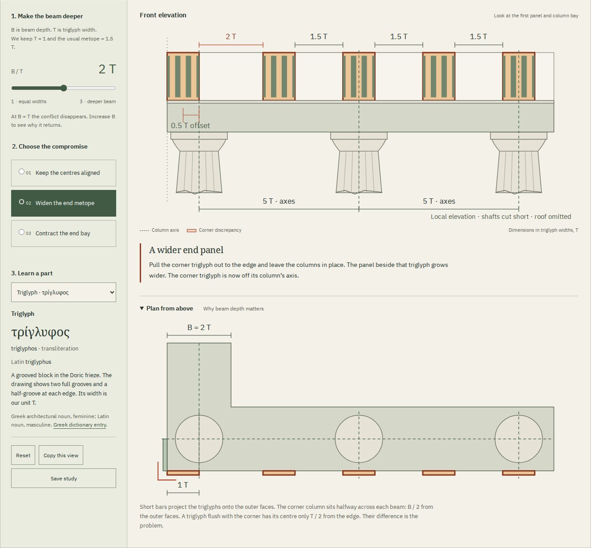

# Gonia

**Measured experiments in ancient architecture, with Greek words, Latin instructions and the printed evidence.**

[Live workshop](https://antonsoo.github.io/gonia/) · [MIT license](LICENSE)

Two problems you can change and measure:
- [The Doric corner](https://antonsoo.github.io/gonia/): which alignment gives
  way when columns and a triglyph frieze meet at a corner?
- [The space between columns](https://antonsoo.github.io/gonia/spacing.html):
  why does Vitruvius leave a wider opening in the middle of an eustyle front?

A regular row of columns and a regular triglyph frieze cannot both keep their
usual alignment at the corner when the beam is deeper than a triglyph is wide.
Gonia lets you change that depth and see exactly what each architectural
compromise preserves. It connects a geometric problem to the physical parts
of a Greek temple and to Vitruvius's account of the difficulty.



## Try it

Open the [widened-metope example](https://antonsoo.github.io/gonia/?b=2.00&t=widen#workshop).
The first panel is 2 triglyph widths wide; ordinary panels are 1.5. Choose
**Contract the end bay**: the panels become equal, while the first column bay
shrinks from 5 to 4.5. The corner triglyph remains 0.5 widths off its column axis.

Move the beam slider to 1. All three treatments now coincide. Move it back
towards 3 and the conflict grows again. Open the plan to see the depth that
the front elevation hides.
- Compare three treatments through linked, measured SVG drawings.
- Highlight a part and read its English, ancient Greek and Latin names.
- Read four sentences of Vitruvius IV.3.2 alongside a new English translation.
  The corresponding scanned pages are included.
- Copy a link to the selected geometry, or save a self-contained HTML study
  with both drawings, measurements, vocabulary and source passage.
- Use the workshop and source PDF offline after the footer confirms they are
  saved. No accounts, analytics, remote fonts or runtime services.

## Change the entrance

Open the [six-column eustyle front](https://antonsoo.github.io/gonia/spacing.html?system=eustyle&n=6&hold=front&front=18&centre=wide#spacing-workshop).
Its six columns, four ordinary gaps and central opening add up to eighteen
lower diameters: `6 + 4 × 2.25 + 3 = 18`. At an 18-metre front, each lower
diameter is therefore 1 metre.

Select **Try making every gap equal**. Keeping the front fixed increases
the diameter to about 1.043 metres. Hold the diameter at 1 metre instead and
the front contracts to 17.25 metres. The drawing, comparison, shared link and
saved reading identify this as your alteration of the ancient prescription.

Compare all five spacing systems at a common drawing scale; change between
four, six and eight columns; distinguish clear intervals from axis-to-axis bays.
Read the Latin, learn six Greek word-parts, and inspect the four bundled pages
of Krohn's 1912 edition. The HTML download includes the actual page images and
opens offline. Araeostyle spacing remains a chosen illustration: the cited
passage supplies no fixed numerical gap.

| System     | Ordinary clear gap / D | Central gap / D | Height / D |
| ---------- | ---------------------: | --------------: | ---------: |
| Pycnostyle |                    1.5 |             1.5 |         10 |
| Systyle    |                      2 |               2 |        9.5 |
| Eustyle    |                   2.25 |               3 |        9.5 |
| Diastyle   |                      3 |               3 |        8.5 |
| Araeostyle |         Chosen example |  Chosen example |          8 |

These are Vitruvius's idealized instructions before his later corner-thickening
adjustment, not measurements of a named temple. Metres provide a modern scale.
The model omits structural loads, entasis and measured base/capital profiles.
[Review and reproducible evidence](docs/spacing-review.md) ·
[Saved illustrated reading](examples/eustyle-altered-reading.html) ·
[Six-page PDF](examples/eustyle-altered-reading.pdf).

## Run locally

Node 24 or newer:

```sh
git clone https://github.com/antonsoo/gonia.git
cd gonia && npm ci
npm run dev
```

Open `http://127.0.0.1:4328/gonia/`. `npm run build` produces the static site in
`dist/`; `npm run preview` serves that build at the same address.

## The model

The outer corner is the origin. A corner column centred under two perpendicular
beams lies half a beam depth from each face. A triglyph flush with that corner
has its centre half a triglyph width from the edge.

```text
Corner face        Flush triglyph centre      Corner column axis
     0 ---------------- T/2 ---------------------- B/2
                          <---- discrepancy ---->

discrepancy = (B - T) / 2
normal column bay = 2 * (triglyph width + metope width) = 5 T
```

For the default B = 2T:

| Treatment            | End metope | End bay, axis to axis | Strip before triglyph | Corner triglyph off-axis |
| -------------------- | ---------: | --------------------: | --------------------: | -----------------------: |
| Keep centres aligned |      1.5 T |                   5 T |                 0.5 T |                      0 T |
| Widen end metope     |        2 T |                   5 T |                   0 T |                    0.5 T |
| Contract end bay     |      1.5 T |                 4.5 T |                   0 T |                    0.5 T |

The pure geometry is in [`src/core/corner.ts`](src/core/corner.ts). Drawings,
interface and exports consume the same coordinates. Share state is bounded
and carried in query parameters, so links to sections do not erase it.
The build creates an offline cache with integrity checks for every saved file.

## Evidence and limits

An independent Python solver sets up eight positional constraints using exact
rational arithmetic, solves for the column and triglyph positions, then measures
the resulting gaps and widths. Across all 603 supported depth/treatment
combinations it checked 9,648 coordinates and distances; the largest difference
was `1.7763568394002505e-15 T`, below a `1e-12 T` tolerance.
See [`docs/geometry-review.json`](docs/geometry-review.json).

The browser review exercises real keyboard controls, all treatments and
vocabulary entries, source-to-drawing links, exported documents, and offline
reloads with the origin's sockets actually disabled. It runs in Chromium and
Firefox at 1440 and 375 pixels and includes automated accessibility checks.
See [verification notes](docs/verification.md) for the reviewed revision and
the scope of those results. These checks establish the application's behavior,
not historical certainty.

This is an **idealized local corner**, not a reconstruction of a named building.
It uses one intermediate triglyph per normal column bay and square ordinary
metopes. Column profiles are illustrative. Roof, sculpture, colour, entasis,
load calculations and whole-building refinements are omitted. The equal-width
endpoint is a geometric limit, not proof of a historical timber construction.

Vitruvius's half-triglyph adjustment agrees with the model at B = 2T; it is not
the discrepancy at every beam depth. His full prescribed temple scheme is not
reproduced here. The source reader keeps his criticism separate from the modern
geometric explanation.

## Sources

- Vitruvius, _De architectura_ IV.3.2, ed. F. Krohn (Teubner, 1912), pp. 82–83.
  [Archive scan](https://archive.org/details/vitruviidearchit00vitr_1/page/82/mode/2up).
- Vitruvius, _De architectura_ III.3.2–10, same edition, pp. 64–67.
  [Archive scan](https://archive.org/details/vitruviidearchit00vitr_1/page/64/mode/2up).
  Height follows the explicit nine-and-a-half reading in III.3.10.
- Mark Wilson Jones, “Doric Measure and Architectural Design 2: A Modular
  Reading of the Classical Temple,” _AJA_ 105.4 (2001), 675–713, especially
  fig. 2, p. 677. [DOI](https://doi.org/10.2307/507412).
- Greek vocabulary checked against LSJ / Perseus; individual entries are linked
  in the workshop. [Material provenance and licenses](THIRD_PARTY.md).

## Development

```sh
npm run check
npm run verify:geometry
npm run verify:spacing
npm run test:browser -- /tmp/gonia-browser-review.json
npm run test:spacing -- /tmp/gonia-spacing-review/browser.json
python3 scripts/spacing-oracle.py /tmp/gonia-spacing-review/browser.json
```

The independent oracle requires Python 3. The browser review requires
Playwright Chromium and Firefox; install them with
`npx playwright install chromium firefox` if needed.
It serves `dist/` itself and writes its screenshots and saved documents beside
the requested report.

[Contributing](CONTRIBUTING.md) explains the source and review standards.
Code, original drawings and translations: [MIT](LICENSE), Anton Soloviev, 2026.
Source scans and fonts have the terms described in [THIRD_PARTY.md](THIRD_PARTY.md).
