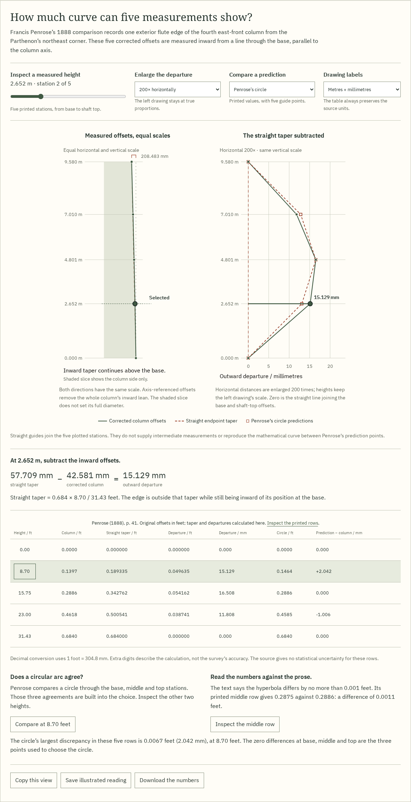
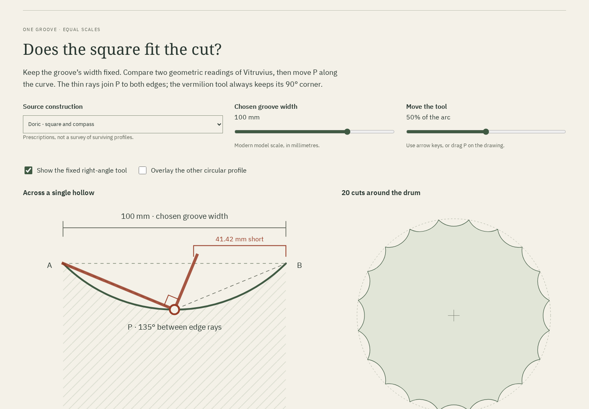
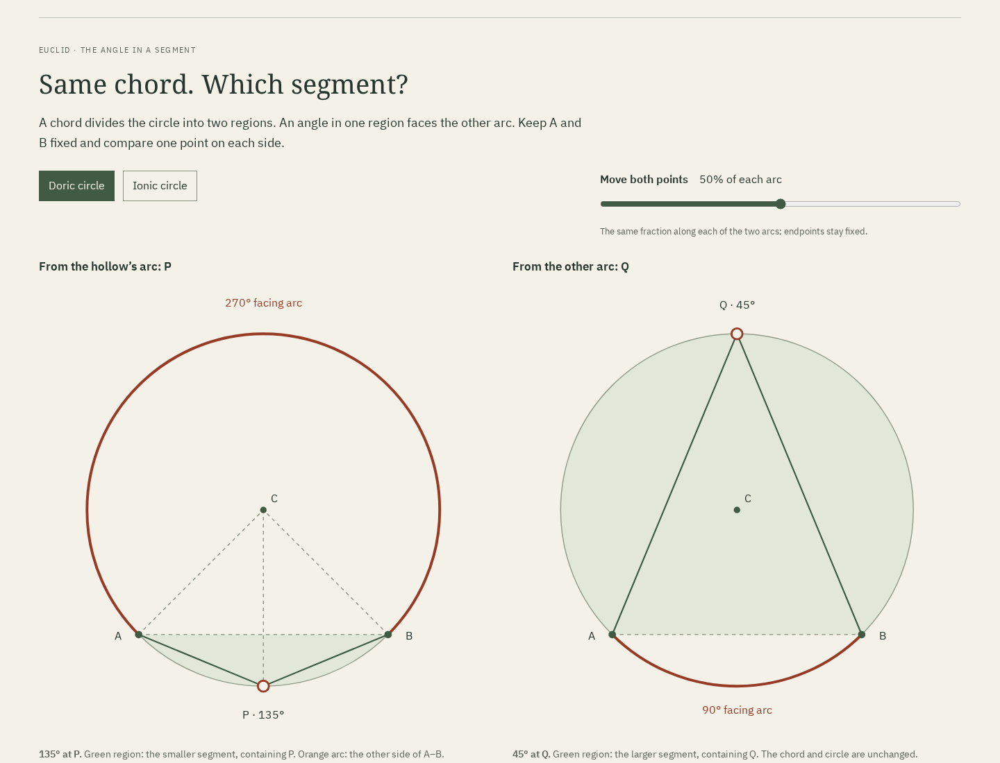
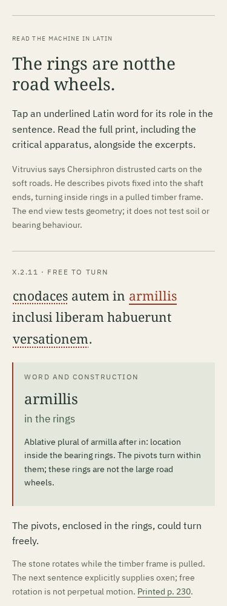

# Gonia

**Measured experiments in ancient architecture, with Greek words, Latin instructions and the printed evidence.**

[Live workshop](https://antonsoo.github.io/gonia/) · [MIT license](LICENSE)

Six problems you can inspect and measure:
- [The Doric corner](https://antonsoo.github.io/gonia/): which alignment gives
  way when columns and a triglyph frieze meet at a corner?
- [The space between columns](https://antonsoo.github.io/gonia/spacing.html):
  why does Vitruvius leave a wider opening in the middle of an eustyle front?
- [The curve inside the taper](https://antonsoo.github.io/gonia/entasis.html):
  how do Penrose's measured Parthenon offsets differ from a straight taper,
  a circle and his hyperbola predictions?
- [The cut inside a column](https://antonsoo.github.io/gonia/fluting.html):
  why does a right-angle tool fit one prescribed flute but miss the other?
- [Before the column stood](https://antonsoo.github.io/gonia/transport.html):
  how can wheels carry a rectangular stone, and why does a geometric fit fail
  to explain a reported failed journey?
- [The row that is not there](docs/colonnade-review.md), new in this checkout:
  what happens to a temple's surrounding passage when an inner colonnade is
  omitted, and why do the text and apparatus disagree about the count?

A regular row of columns and a regular triglyph frieze cannot both keep their
usual alignment at the corner when the beam is deeper than a triglyph is wide.
Gonia lets you change that depth and see exactly what each architectural
compromise preserves. It connects a geometric problem to the physical parts
of a Greek temple and to Vitruvius's account of the difficulty.


## Try it

Open the [widened-metope example](https://antonsoo.github.io/gonia/?b=2.00&t=widen#workshop).
The first panel is 2 triglyph widths wide; ordinary panels are 1.5. Choose
**Contract the end bay**: the panels become equal, while the first column bay
shrinks from 5 to 4.5. The corner triglyph remains 0.5 widths off its column axis.

Move the beam slider to 1. All three treatments now coincide. Move it back
towards 3 and the conflict grows again. Open the plan to see the depth that
the front elevation hides.
- Compare three treatments through linked, measured SVG drawings.
- Highlight a part and read its English, ancient Greek and Latin names.
- Read four sentences of Vitruvius IV.3.2 alongside a new English translation.
  The corresponding scanned pages are included.
- Copy a link to the selected geometry, or save a self-contained HTML study
  with both drawings, measurements, vocabulary and source passage.
- Use the workshop and source PDF offline after the footer confirms they are
  saved. No accounts, analytics, remote fonts or runtime services.

## Omit a colonnade; keep the temple's breadth

The new temple-plan room is available locally at
`http://127.0.0.1:4328/gonia/colonnade.html` after starting the app.
[Review and publication boundary](docs/colonnade-review.md).


Keep the outer row and simplified cella block fixed. Choose **Keep both rings**,
then **Omit the inner ring**. At the chosen 2.25-diameter clear gap, two narrow
lanes and the former shaft position join into a 5.5-diameter strip. A separate
detail measures between shaft faces, rather than confusing clear gaps with
axis pitches. Phones receive a complete upright plan and passage detail.

Trace the outer or inner ring one position at a time. Eight across an end and
fifteen along a flank describe a boundary, not a filled grid. Corners count once:

| Model ring | Ends, including corners | Flanks, excluding corners | Total |
| ---------- | ----------------------- | ------------------------- | ----- |
| Outer      | 2 × 8                   | 2 × 13                    | 42    |
| Inner      | 2 × 6                   | 2 × 11                    | 34    |

Vitruvius's editor prints **34** removed columns, but the apparatus records
**38**. The workshop exposes the discrepancy; a regular grid cannot settle
the textual or archaeological question. Read five Latin excerpts with six
grammar notes, connect Greek headwords to parts, and enlarge the actual
apparatus entry. Compare the 1904 excavation publication's preserved-state
plan, proposed restoration and capital photograph. The restored temple has
porch and interior columns beyond the model's rings.

Save all 76 potential ring positions as CSV, including present/omitted flags,
or save an illustrated reading with both arrangements, fonts, licenses and
all five complete source images embedded and verified by SHA-256.
[Offline HTML reading](examples/colonnade-reading.html) ·
[Printable PDF](examples/colonnade-reading.pdf) ·
[Coordinates](examples/colonnade.csv) ·
[Model and source decisions](docs/colonnade-model.md).

This is a regular geometric experiment in shaft diameters. It omits bases,
porches, interior columns, steps and roof supports. It computes no crowd
capacity, structural adequacy, price or measured Magnesia reconstruction.

## Change the entrance

Open the [six-column eustyle front](https://antonsoo.github.io/gonia/spacing.html?system=eustyle&n=6&hold=front&front=18&centre=wide#spacing-workshop).
Its six columns, four ordinary gaps and central opening add up to eighteen
lower diameters: `6 + 4 × 2.25 + 3 = 18`. At an 18-metre front, each lower
diameter is therefore 1 metre.

Select **Try making every gap equal**. Keeping the front fixed increases
the diameter to about 1.043 metres. Hold the diameter at 1 metre instead and
the front contracts to 17.25 metres. The drawing, comparison, shared link and
saved reading identify this as your alteration of the ancient prescription.

Compare all five spacing systems at a common drawing scale; change between
four, six and eight columns; distinguish clear intervals from axis-to-axis bays.
Read the Latin, learn six Greek word-parts, and inspect the four bundled pages
of Krohn's 1912 edition. The HTML download includes the actual page images and
opens offline. Araeostyle spacing remains a chosen illustration: the cited
passage supplies no fixed numerical gap.

| System     | Ordinary clear gap / D | Central gap / D | Height / D |
| ---------- | ---------------------: | --------------: | ---------: |
| Pycnostyle |                    1.5 |             1.5 |         10 |
| Systyle    |                      2 |               2 |        9.5 |
| Eustyle    |                   2.25 |               3 |        9.5 |
| Diastyle   |                      3 |               3 |        8.5 |
| Araeostyle |         Chosen example |  Chosen example |          8 |

These are Vitruvius's idealized instructions before his later corner-thickening
adjustment, not measurements of a named temple. Metres provide a modern scale.
The model omits structural loads, entasis and measured base/capital profiles.
[Review and reproducible evidence](docs/spacing-review.md) ·
[Saved illustrated reading](examples/eustyle-altered-reading.html) ·
[Six-page PDF](examples/eustyle-altered-reading.pdf).

## Inspect a measured column edge

Open [the entasis workshop](https://antonsoo.github.io/gonia/entasis.html).
The Parthenon edge is drawn at equal horizontal and vertical scales. Beside it,
a second drawing subtracts the straight endpoint taper and enlarges the small
outward departures. Select one of five printed heights to connect the point,
original offset, calculation and table row.

At 15.75 feet, straight taper gives 0.342762 feet inward; Penrose's corrected
column offset is 0.2886 feet. The difference is 16.508 mm outward from that
taper. It remains inward of the base: entasis need not make a column wider
than its bottom.

Compare Penrose's printed circle and hyperbola predictions. The circle passes
through the base, middle and top by construction; inspect the other two rows
instead of mistaking those three agreements for independent evidence. The
hyperbola's printed middle row differs by 0.0011 feet, although Penrose's prose
says the differences do not exceed 0.001. Both readings remain visible.

The workshop also compares six reported maxima at actual size and equal
shaft length, reads Vitruvius III.3.13 with Greek and Latin vocabulary, and
includes five complete source images. Download the numerical CSV or a
self-contained illustrated reading; all five workshops and their source
packets are available offline after the footer confirms the complete edition.

The five points do not establish a continuous measured profile, an ancient
construction method or an optical effect. [Source decisions](docs/entasis-design.md)
and the [reviewed browser and source evidence](docs/entasis-review.md) explain
these boundaries. The drawings join stations with explicit guides;
they do not invent intermediate observations.



A [saved circle comparison](examples/entasis-circle-reading.html.gz) and its
[eight-page PDF](examples/entasis-circle-reading.pdf) include all five scans. Extract the gzip HTML before opening; it retains the original captured reading bytes.

## Take a carving template to paper

Open [the flute workshop](https://antonsoo.github.io/gonia/fluting.html#fluting-workshop).
Keep a groove 100 mm wide, and move the corner of a right-angle tool along it.
The Doric square-and-compass construction gives a quarter-circle hollow;
Vitruvius's Ionic moving-square test is consistent with a semicircle.

| Same 100 mm chord            | Hollow depth | Angle from P to both edges | Second tool contact at midpoint |
| ---------------------------- | -----------: | -------------------------: | ------------------------------: |
| Doric compass construction   | 20.710678 mm |                135 degrees |         41.421356 mm short of B |
| Ionic semicircle             |        50 mm |                 90 degrees |                         Meets B |
| Doric flat-faced alternative |         0 mm |       Collinear; no hollow |         Not a hollow-gauge test |

Repeat the actual concave arcs around a 20- or 24-division shaft. Choose an
illustrative Ionic fillet width; compare the removed area and shaft diameter
while keeping the groove chord fixed. These are model dimensions and source
prescriptions, not measured profiles or structural predictions.

Download a millimetre-scaled SVG with a 25 mm calibration bar, or a
self-contained illustrated reading with all three complete source pages,
fonts, Latin grammar and Aristotle's Greek nested genitives. Its embedded
CSV and SVG downloads work from a native offline file. Physical printer
scaling remains unverified; the generated PDF's bar measures 24.999824 mm.

[Source decisions](docs/fluting-sources.md) · [Review](docs/fluting-review.md) ·
[Saved reading](examples/fluting-reading.html) · [Original carving PDF](examples/fluting-reading.pdf) ·
[Paper template](examples/fluting-doric-100mm.svg) · [Coordinates](examples/fluting.csv)



## Why 135 degrees from one arc, but 45 from the other?

Open [the two-segment comparison](https://antonsoo.github.io/gonia/fluting.html#segment-study).
The same chord divides one circle into two regions. Move P in the hollow and
Q on the other arc. Green identifies the region containing the point; orange
marks the arc facing it. In the Doric circle, P keeps 135 degrees and Q keeps
45. In the Ionic circle, both keep 90.

Two isosceles triangles explain P's angle as a sum of changing base angles.
The cyclic quadrilateral explains why Q is supplementary. Read Euclid III.31's
Greek beside Heiberg's explicitly modern Latin translation and a new English
translation. Learn how “in the larger segment” can describe the smaller angle,
and why “angle in a segment” differs from “angle of a segment.”

The companion CSV records both points on both arcs. The new portable reading
includes both diagrams, the calculation, all five full source pages, fonts,
licenses and a working download of those comparison coordinates. The
[original carving reading](examples/fluting-reading.html) is retained as its
reviewed earlier edition.

[Source decisions](docs/segments-sources.md) · [Review](docs/segments-review.md) ·
[Complete reading](examples/segment-reading.html) · [Printable PDF](examples/segment-reading.pdf) ·
[Both-arc coordinates](examples/segment-angles.csv)



## Before the column stood

[Roll the stone](https://antonsoo.github.io/gonia/transport.html#transport-workshop).
Compare a circular shaft, a bare rectangular stone and a stone turning inside
wheels. The end view follows the centre while the road ruler moves beneath it.
The height graph exposes the difference between rolling on a circle and tipping
about successive corners.

| Chosen 8 × 6 section | Centre height                   | Minimum full-turn clearance           |
| -------------------- | ------------------------------- | ------------------------------------- |
| Bare rectangle       | Rises and falls between 3 and 5 | Touches the road while tipping        |
| Radius-6 wheels      | Constant 6                      | 1                                     |
| Radius-4 wheels      | Attempted constant 4            | -1; blocked between the quarter-turns |

The bare rectangle is a modern counterexample, not a prescribed ancient method.
The source gives no cross-section for Metagenes's beams; these initial dimensions
are chosen. Try a wheel that is too small: it clears at 0° and 90° but intersects
the road in between. The red region shows the obstruction instead of presenting
that attempted motion as physically possible.

[Paconius's reported dimensions](https://antonsoo.github.io/gonia/transport.html?kind=wheels&w=8&h=6&r=7.5&angle=53&unit=feet&page=231#transport-workshop)
give an 8 × 6 end section, a five-foot half-diagonal and a 7½-foot wheel radius
under the stated diameter/axis readings. The resulting 2½ source feet of
clearance do not explain why, according to Vitruvius, the rope-driven machine
veered and had to be pulled back. This model supplies no steering, soil or force
estimate.

Five Latin excerpts, nine selectable grammar notes and three Greek technical
headwords explain pivots, bearing rings, rollers and architraves. Complete
Krohn pages 230–231 include the critical apparatus and the gap in the frame
description. Enlarge and pan either the diagram or the original print.
Keep a shared pose, download the selected position plus all 361 full-turn
samples, or save an illustrated reading with both source pages, fonts and
licenses embedded. All five rooms are available in the complete offline edition.

The [transport model](docs/transport-model.md) gives the geometric derivation,
source readings and limits. Its independent checker moves a complete polygon
around successive support vertices; it does not import the app's formula.

```sh
npm run verify:transport
npm run test:transport -- /tmp/gonia-transport
node --import tsx scripts/transport-cases.ts | python3 scripts/transport-oracle.py /tmp/gonia-transport/review.json
python3 scripts/transport-source-review.py
```

Build first and keep `dist/` unchanged during the browser review. It uses
installed Playwright Chromium and Firefox, and opens actual native downloads.
The source reviewer requires Poppler and verifies the identified original PDF
and the bundled two-page PDF against the exact JPEGs. Supply `--pdf <path>` to
use an existing copy of that original. The [source manifest](docs/transport-source-identities.json)
records all identities and the Greek dictionary entries.

The [transport review](docs/transport-review.md) retains the public browser,
source, print and clean-install evidence. Try the actual [saved reading](examples/transport-reading.html),
[seven-page A4 PDF](examples/transport-reading.pdf) and [complete-turn CSV](examples/transport-paconius.csv).



## Run locally

Node 24 or newer:

```sh
git clone https://github.com/antonsoo/gonia.git
cd gonia && npm ci
npm run dev
```

Open `http://127.0.0.1:4328/gonia/`. `npm run build` produces the static site in
`dist/`; `npm run preview` serves that build at the same address.

## The model

The outer corner is the origin. A corner column centred under two perpendicular
beams lies half a beam depth from each face. A triglyph flush with that corner
has its centre half a triglyph width from the edge.

```text
Corner face        Flush triglyph centre      Corner column axis
     0 ---------------- T/2 ---------------------- B/2
                          <---- discrepancy ---->

discrepancy = (B - T) / 2
normal column bay = 2 * (triglyph width + metope width) = 5 T
```

For the default B = 2T:

| Treatment            | End metope | End bay, axis to axis | Strip before triglyph | Corner triglyph off-axis |
| -------------------- | ---------: | --------------------: | --------------------: | -----------------------: |
| Keep centres aligned |      1.5 T |                   5 T |                 0.5 T |                      0 T |
| Widen end metope     |        2 T |                   5 T |                   0 T |                    0.5 T |
| Contract end bay     |      1.5 T |                 4.5 T |                   0 T |                    0.5 T |

The pure geometry is in [`src/core/corner.ts`](src/core/corner.ts). Drawings,
interface and exports consume the same coordinates. Share state is bounded
and carried in query parameters, so links to sections do not erase it.
The build creates an offline cache with integrity checks for every saved file.

## Evidence and limits

An independent Python solver sets up eight positional constraints using exact
rational arithmetic, solves for the column and triglyph positions, then measures
the resulting gaps and widths. Across all 603 supported depth/treatment
combinations it checked 9,648 coordinates and distances; the largest difference
was `1.7763568394002505e-15 T`, below a `1e-12 T` tolerance.
See [`docs/geometry-review.json`](docs/geometry-review.json).

The browser review exercises real keyboard controls, all treatments and
vocabulary entries, source-to-drawing links, exported documents, and offline
reloads with the origin's sockets actually disabled. It runs in Chromium and
Firefox at 1440 and 375 pixels and includes automated accessibility checks.
See [verification notes](docs/verification.md) for the reviewed revision and
the scope of those results. These checks establish the application's behavior,
not historical certainty.

The corner workshop is an **idealized local corner**, not a reconstruction of a named building.
It uses one intermediate triglyph per normal column bay and square ordinary
metopes. Column profiles are illustrative. Roof, sculpture, colour, entasis,
load calculations and whole-building refinements are omitted. The equal-width
endpoint is a geometric limit, not proof of a historical timber construction.

Vitruvius's half-triglyph adjustment agrees with the model at B = 2T; it is not
the discrepancy at every beam depth. His full prescribed temple scheme is not
reproduced here. The source reader keeps his criticism separate from the modern
geometric explanation.

## Sources

- Vitruvius, _De architectura_ IV.3.2, ed. F. Krohn (Teubner, 1912), pp. 82–83.
  [Archive scan](https://archive.org/details/vitruviidearchit00vitr_1/page/82/mode/2up).
- Vitruvius, _De architectura_ III.3.2–10, same edition, pp. 64–67.
  [Archive scan](https://archive.org/details/vitruviidearchit00vitr_1/page/64/mode/2up).
  Height follows the explicit nine-and-a-half reading in III.3.10.
- Francis Penrose, _An Investigation of the Principles of Athenian
  Architecture_, second edition (1888), pp. 39–41 and plate XIV.
  [Heidelberg scan](https://digi.ub.uni-heidelberg.de/diglit/penrose1888/0054).
  Five corrected offsets and two sets of predictions come from p. 41;
  six reported maxima and shaft lengths come from p. 40.
- Vitruvius, _De architectura_ III.3.13, Krohn (1912), p. 68.
  [Archive scan](https://archive.org/details/vitruviidearchit00vitr_1/page/68/mode/2up).
- Alain Goriely, “The illusion of illusions: There are no optical corrections
  in the Parthenon,” [2026 analysis](https://arxiv.org/html/2510.16831v2).
  Linked as a contrasting interpretation; its figures are not reused.
- Mark Wilson Jones, “Doric Measure and Architectural Design 2: A Modular
  Reading of the Classical Temple,” _AJA_ 105.4 (2001), 675–713, especially
  fig. 2, p. 677. [DOI](https://doi.org/10.2307/507412).
- Greek vocabulary checked against LSJ / Perseus; individual entries are linked
  in the workshop. [Material provenance and licenses](THIRD_PARTY.md).

## Development

```sh
npm run check
npm run verify:geometry
npm run verify:spacing
npm run verify:entasis
npm run verify:fluting
npm run verify:segments
npm run verify:colonnade
npm run test:colonnade -- /tmp/gonia-colonnade-review
npm run test:browser -- /tmp/gonia-browser-review.json
npm run test:spacing -- /tmp/gonia-spacing-review/browser.json
python3 scripts/spacing-oracle.py /tmp/gonia-spacing-review/browser.json
npm run test:entasis -- /tmp/gonia-entasis-review/browser.json
python3 scripts/entasis-oracle.py /tmp/gonia-entasis-review/browser.json
npm run test:fluting -- /tmp/gonia-fluting-review
python3 scripts/fluting-oracle.py /tmp/gonia-fluting-review/browser.json
# With npm run preview in another terminal:
npm run test:segments -- http://127.0.0.1:4328/gonia/ /tmp/gonia-segments-review
python3 scripts/segments-oracle.py /tmp/gonia-segments-review/browser.json
# Optional native PDF inspection (requires uv):
uv run scripts/fluting-print-review.py /tmp/gonia-fluting-review
```

The independent oracle requires Python 3. The browser review requires
Playwright Chromium and Firefox; install them with
`npx playwright install chromium firefox` if needed.
It serves `dist/` itself and writes its screenshots and saved documents beside
the requested report.

[Contributing](CONTRIBUTING.md) explains the source and review standards.
Code, original drawings and translations: [MIT](LICENSE), Anton Soloviev, 2026.
Source scans and fonts have the terms described in [THIRD_PARTY.md](THIRD_PARTY.md).
