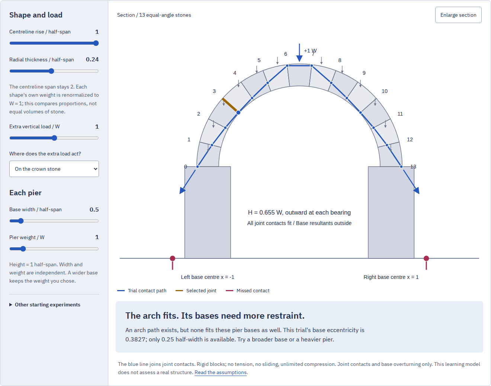

# Direct review of the arch and pier workshop

Local review on 2026-10-27. The source text, numerical model, downloaded
documents, clean build, browser behavior and public delivery are separate
claims. The source review used the actual printed pages and a fresh download
of the original PDF; previous progress notes were not used as evidence.

## Try the actual work

1. Open `arch.html#ar-bench`, or choose **Arch and pier** from Gonia's root.
   The opening example has fourteen contacts inside the radial joints. Its
   base resultants lie outside the selected bases. The complete domain check
   finds an arch path but no joint-and-base path under these assumptions.
2. Increase base width from 0.5 to 1 half-span. The current trial now fits both
   checks. Pier weight stays 1 W: a wider base does not silently add weight.
3. Use **Include the pier bases** to find one equilibrium witness. Open every
   joint in the rotated, enlarged inspector. Its numbers also appear in the
   all-contacts table; the small mobile overview is not the only reading route.
4. Try the thin semicircle. No H/bearing pair fits every joint. Try a shallow
   thick ring: unlimited compression can admit an unbounded ideal H interval,
   while the automatic witness remains finite. These outcomes are explicitly
   limited to the finite model.
5. Move the same extra weight from the crown to the shoulders. Compare the
   changed complete thrust interval, not just the blue line of one trial.
6. Read `latiores … sunt faciundae` beside the printed page. Select a word to
   connect the forms of `cunei`, `coagmenta`, `pilae` and the other terms to
   their architectural jobs. The five readings and eight notes remain
   distinct from our modern statics.
7. Save the experiment and reopen its JSON. The illustrated HTML carries all
   readings, source images, fonts, licenses and native downloads. Reopen it
   with scripting disabled; print it for a PDF.



[Mobile section and controls](assets/arch-mobile.png) ·
[Parallel readings and the printed evidence](assets/arch-reading.png).

## Observed evidence

| Claim                        | Direct evidence                                                                                                                                                                                                                         |
| ---------------------------- | --------------------------------------------------------------------------------------------------------------------------------------------------------------------------------------------------------------------------------------- |
| Ancient text and edition     | Three whole printed pages visually inspected; selected Latin checked against p. 141; fresh original PDF hash and page mapping in [source note](arch-sources.md)                                                                         |
| Complete model interval      | 160 shape/load cases, 320 domains, 640 independent SciPy/HiGHS LP optimizations; 255 feasible and 65 infeasible domains; largest finite endpoint difference 7.816e-14 W                                                                 |
| Model oracle independence    | Production eliminates a scalar C from affine inequalities; the Python oracle balances forces and moments on all thirteen blocks using nonnegative inner/outer normal forces and free shear, with independently integrated centroids     |
| Clean installation           | Fresh local clone at `f069f30f28eb16ad94de9daba6dff9eb5e4dc96d`; Node 24.21.0, `npm ci`, `npm run check` and `npm run verify:arch`; lint/typecheck, all 65 tests and production build passed                                            |
| Real browser behavior        | Chromium and Firefox at 1440 and 375 pixels: root discovery, native keyboard controls, all fourteen joint inspectors, word notes, source zoom/pan, malformed import, exact non-rounded JSON/link reopening and real downloads           |
| Source identities            | Actual displayed image blobs hashed against all three retained identities; another valid JPEG returned with HTTP 200 was refused both in the viewer and illustrated export; retry succeeded                                             |
| Concurrency                  | A held earlier page response could not replace the chosen title page; an export held during a subsequent width/page change retained the settings at its original click                                                                  |
| Offline edition              | After current-worker takeover and a complete 141-file cache inventory, offline reloads mounted all fifteen rooms; the new room read all source pages and saved the illustrated file offline                                             |
| Browser errors/accessibility | No page errors or external requests in the four complete room journeys; no axe violations under the checked WCAG 2 A/AA and 2.1 A/AA rule tags                                                                                          |
| Real artifacts               | All four browsers' JSON/CSV/SVG/HTML files checked independently: fourteen joint identities, thirteen block moment balances, pier-base moment balance, actual source/font bytes and complete licenses                                   |
| Retained reading             | Three source images and two fonts byte-identical; complete MIT and two OFL notices; four native file downloads; script-disabled reopening with no remote asset requests                                                                 |
| PDF                          | Actual 14-page Chromium output includes all fifteen Latin/English/note paragraphs, all eight complete word notes and all three source images; extracted words fit the checked margins; first and source-reading pages visually reviewed |
| Public delivery / remote CI  | Not performed for this addition. Local source commits and a complete production edition are ready for the publication coordinator; no hosted-byte or remote-CI success is asserted                                                      |

The source/frontend commit above includes the complete production inputs.
The later documentation and examples do not enter the edition hash.
Source, native artifact and browser receipts are retained in
[the evidence directory](evidence/arch/). Browser URLs in these receipts are
ephemeral local preview addresses.

## Reproduce

```sh
npm ci
npm run check
npm run verify:arch
```

Serve `dist/` with `npm run preview`, then in another terminal:

```sh
npm run test:arch -- http://127.0.0.1:4328/gonia/ /tmp/gonia-arch-review
python3 scripts/arch-artifacts.py /tmp/gonia-arch-review
```

The optional oracle uses `uv` and SciPy 1.18.1. Artifact/PDF checks need Python 3
and Poppler. The production command is **`npm run build`**, output **`dist/`**.
Browser prerequisites are the same cached Chromium/Firefox used by the other
rooms. Source reproduction is recorded separately in [arch-sources.md](arch-sources.md).

## Limits retained

The inspected path is a locus of joint resultants, not an interior stress
field or a physical collapse animation. This is a symmetric thirteen-block
experiment with no tension, no sliding and unlimited compression. It omits
material strength, friction, settlement, soil bearing, three-dimensional
restraint and construction sequence. The source passages are not a numerical
design recipe. No physical masonry experiment, printer output, tagged-PDF
accessibility or independent philological review is claimed.

The mobile diagram is an overview with an explicit enlarge control; readable
joint values and the rotated inspector provide a separate text/detail route.
Browser and automated accessibility checks do not establish every assistive
technology's behavior. SVG text depends on the viewer's installed sans-serif
font. The retained HTML embeds its own fonts.
