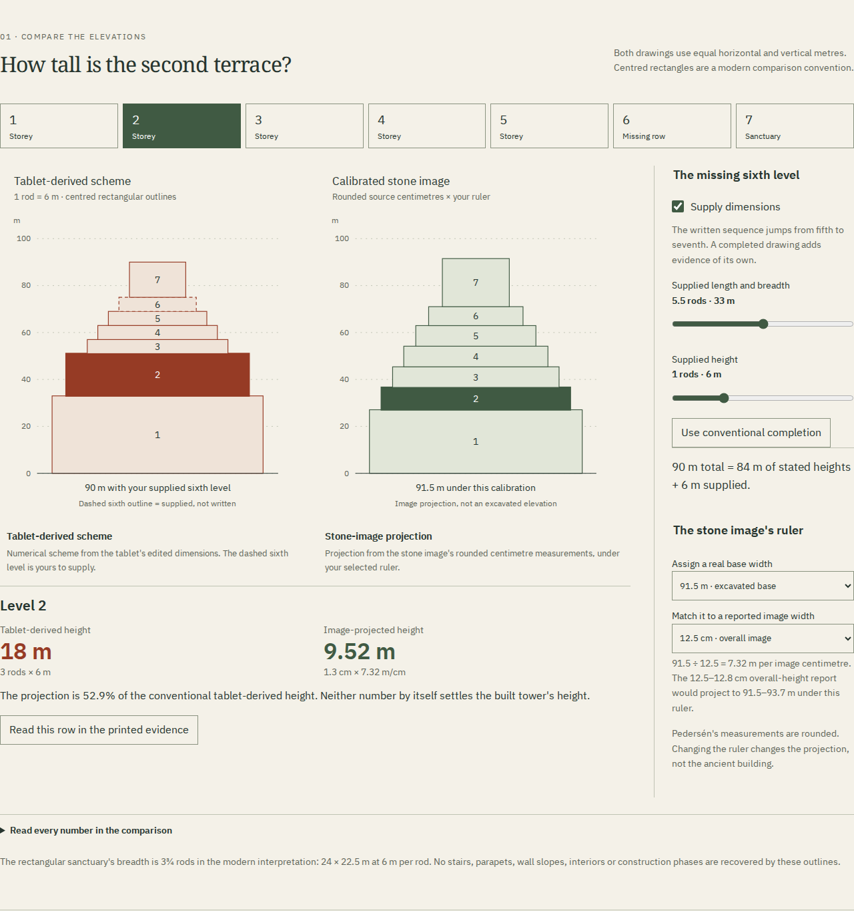

# Babylon: learner workflow and local evidence

## What changed for the learner

Gonia's thirteenth room asks what can be inferred when a numerical text and
a carved image disagree. It keeps the missing sixth storey in the Esagil tablet
visible, permits a disclosed modern completion, and compares that scheme with
a uniformly calibrated projection of the Tower of Babylon stele. The real
photogrammetric stone can be turned and relit; it is never presented as a model
of the ancient building.

This review covers runtime source `4894c4d43cc3039101ec3b59c0f92e9c1f012cdf`.
Publication, hosted bytes and public browser behavior require their own record.
The [source/model analysis](babylon-model.md) explains the conventional readings,
editorial disagreements, units, provenance and limits of the comparison.

## Try the comparison

With Node 24 or newer, run `npm ci`, then `npm run dev`. Open
`http://127.0.0.1:4328/gonia/babylon.html?supplied=0&selected=5&page=scheil-300#bb-bench`.
1. Leave the sixth storey unknown. The stated conventional heights sum to
   84 m, but the total height and the sanctuary's elevation remain unknown.
   Download the CSV: unknown dimensions and the sanctuary's bottom are blank.
2. Supply the conventional sixth row. The resulting scheme reaches 90 m.
   Change its height by quarter-rods: the total changes, while the source's
   other rows stay fixed. The controls are modern hypotheses, not new readings.
3. Select the second storey. Its conventional tablet height is 18 m. The
   image's rounded 1.3 cm projects to 9.516 m with a 91.5 m base and a 12.5 cm
   image ruler. The disagreement survives a common metre scale.
4. Choose the first-terrace 12.4 cm ruler instead of the 12.5 cm overall ruler.
   The projected total changes to about 92.24 m. These extra decimal places
   come from arithmetic on rounded measurements, not more precise excavation.
5. Use **Read this row** for each of the seven levels. The corresponding
   numerical aid receives focus; the complete source page remains available.
   Read _šiddu_, _pūtu_ and _mēlû_ as length, breadth and height in context.
6. Compare the sanctuary plan and elevation. Applying the reported relative
   scale of about 1.8 produces agreement by construction; it does not prove
   a new building dimension.
7. Load the actual stone scan. Turn it, change the light and remove its
   photographic texture. The support remains, and the neutral surface has
   modern averaged normals and illustrative light. A captured view can be
   retained in the illustrated reading.



The [375-pixel view](assets/babylon-mobile.png) retains the numerical controls,
readings, source access and downloads. [Actual scan inspection](assets/babylon-stone.png)
shows captured stone geometry, not invented tower walls.

## Keep the evidence

The retained files are actual native downloads from Chromium at 1440 pixels:
- [Illustrated HTML, gzip-compressed](../examples/babylon-reading.html.gz):
  decompress before opening. It contains seven whole source images, the full
  CC BY 4.0 article, the actual scan snapshot and settings, numerical JSON/CSV,
  three fonts and complete notices. It has no scripts or network dependency.
- [Seventeen-page A4 PDF](../examples/babylon-reading.pdf): printed from that
  HTML. The scan is a static capture; physical printing and tagged-PDF
  accessibility have not been established.
- [Editable record](../examples/babylon-record.json),
  [seven-row comparison CSV](../examples/babylon-comparison.csv) and
  [standalone SVG plate](../examples/babylon-plate.svg).

[Retained-file identities](babylon-review/retained-files.json) connect those
files to the browser's actual downloads. Camera-dependent snapshots can differ
between browsers and viewport sizes; the source images, full source PDF and
fonts are checked against their own retained identities.

## Recorded verification

| Claim                                                   | Evidence and result                                                                                                                                                                                                                                                                                                                                                                                                                     |
| ------------------------------------------------------- | --------------------------------------------------------------------------------------------------------------------------------------------------------------------------------------------------------------------------------------------------------------------------------------------------------------------------------------------------------------------------------------------------------------------------------------- |
| Arithmetic does not turn absence into zero              | [Independent Python Fraction oracle](babylon-review/model.json): 1,056 complete unique cases, separate published numerical tables, no application imports. It also rejects incomplete or repeated case inventories.                                                                                                                                                                                                                     |
| Actual drawings and downloads agree with the arithmetic | [Geometry receipt](babylon-review/geometry.json): 196 rows from 28 actual browser CSVs and 392 actual SVG groups agree with the independent oracle.                                                                                                                                                                                                                                                                                     |
| The scan preserves the deposited surface                | [Mesh audit](babylon-review/mesh.json): all 189,027 triangles and 567,081 corner position/UV correspondences checked against the original OBJ; all 103,234 source positions retained. Float32 coordinate rounding is disclosed.                                                                                                                                                                                                         |
| Source reductions can be reproduced                     | [Source receipt](babylon-review/source-reproduction.json): both complete TCL plates, two unchanged extracted article JPEGs and the reduced texture reproduce byte for byte with the recorded Poppler/Pillow versions.                                                                                                                                                                                                                   |
| The full learner workflow operates                      | [Browser receipt](babylon-review/browser.json): Chromium 153.0.8010.12 and Firefox 155.0 at 1440 and 375 pixels. Seven row-to-reading jumps, all numerical states, keyboard, history, real file-chooser import, rejected malformed records, shared links, source verification, native downloads and scan controls pass. No page/CSP errors or serious/critical axe findings.                                                            |
| The saved edition works as a file                       | In all four contexts, script-disabled HTML/SVG open without HTTP requests; embedded JSON, CSV and PDF downloads match. [Artifact analysis](babylon-review/artifacts.json) verifies seven original JPEGs, the full article PDF, three fonts, scan snapshot, notices and SVG/CSV agreement. The actual printed PDF has 17 pages, seven embedded font instances and no JavaScript; all 3,516 text words remain within the checked margins. |
| Source failures do not silently alter evidence          | Both engines reject a different valid JPEG and a substituted mesh before display/export, then recover on retry. A completed late JPEG response cannot replace the newer selection. Forced WebGL 2 failure retains the verified photograph, numerical work and actual illustrated download. Cases are retained in the browser receipt.                                                                                                   |
| A complete installation works with its origin stopped   | All four local contexts reload from the complete 123-file cache, load a new source page and the actual scan, operate the comparison, save new files and return to the original room after the production server has stopped.                                                                                                                                                                                                            |
| Existing installations survive an interrupted update    | [Four upgrade cases](babylon-review/upgrade.json): both engines, held source and substituted source. The previous twelve-room installation remains usable offline until recovery; the complete new cache supports the new scan and old room, then retires the old cache. No incomplete illustrated download is emitted.                                                                                                                 |
| Development uses the same retained JSON                 | [Babylon development receipt](babylon-review/development.json): both browsers compare raw/public and watched virtual-module data, refuse a source after a controlled digest edit and recover after byte restoration. [Existing optics regression](babylon-review/optics-development.json) also checks both engines; its temporary edit/restore is exercised in Chromium. No direct imports from `public/` occur.                        |
| A fresh supported-runtime install reproduces production | [Build inventory](babylon-review/build.json): clean source archive, fresh `npm ci`, formatting/types/50 tests/build on Node 24.21.0. All 124 output paths and bytes match the reviewed Node 26.7.0 build.                                                                                                                                                                                                                               |

The actual scan runs here through per-process Mesa software rendering because
the WSL host's default graphics path was unavailable. The browser receipt
records that environment. This establishes a working WebGL implementation in
the reviewed engines; it does not establish performance on a hardware GPU.
The unsupported-WebGL fallback was separately exercised.

## Reproduce

With the Playwright browsers and Poppler installed:

```sh
REVIEW_DIR=/tmp/gonia-babylon-review
npm run check
npm run verify:babylon
npm run test:babylon -- "$REVIEW_DIR"
node --import tsx scripts/babylon-cases.ts | python3 scripts/babylon-oracle.py "$REVIEW_DIR"
npm run verify:babylon-files -- "$REVIEW_DIR"
node scripts/babylon-upgrade.mjs "$PREVIOUS_DIST" upgrade.json
```

The browser driver serves the existing `dist/`; do not rebuild during a run.
The upgrade input here was a clean build of `1682b23`, the twelve-room edition.
To reproduce this WSL graphics environment, prefix browser commands with:

```sh
env VK_DRIVER_FILES=/usr/share/vulkan/icd.d/lvp_icd.json \
    VK_ICD_FILENAMES=/usr/share/vulkan/icd.d/lvp_icd.json \
    EGL_PLATFORM=surfaceless LIBGL_ALWAYS_SOFTWARE=true GALLIUM_DRIVER=llvmpipe \
    node scripts/babylon-browser.mjs "$REVIEW_DIR"
```

For development verification, use an isolated writable checkout and its Vite
server: `node scripts/babylon-development.mjs "$DEV_BASE" "$FIXTURE" "$OUT_DIR"`.
The fixture script restores the original bytes. Mesh conversion and the
independent audit require the pinned original files identified in the public
manifest; see `scripts/babylon-mesh.py` and `scripts/babylon-mesh-audit.py`.

These receipts establish local source, artifact and browser claims. They do
not establish a CI run, physical printing, an ancient sound, a new collation
of the tablet, a controlled find context or the actual height of Etemenanki.
