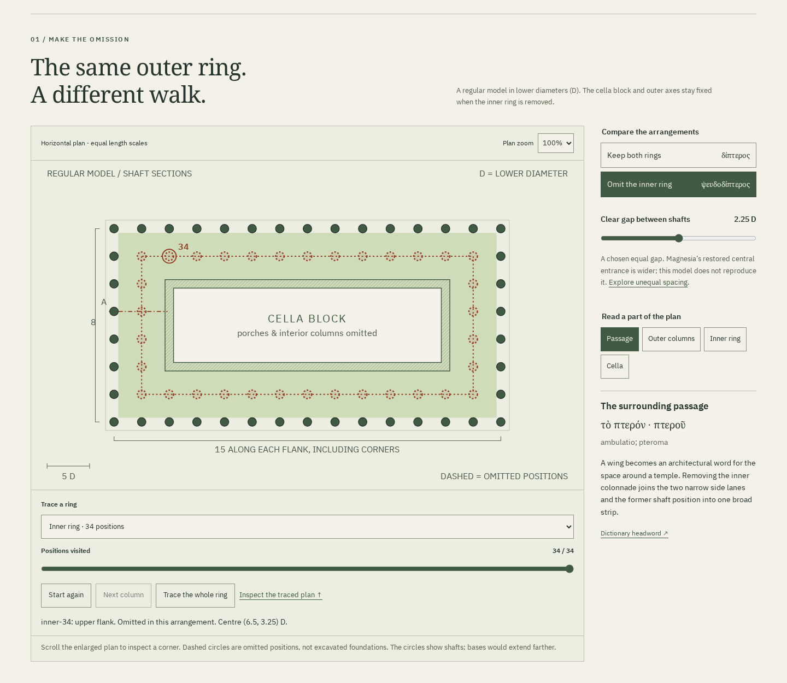
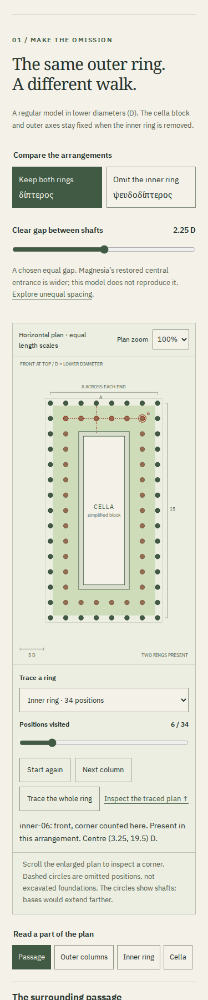
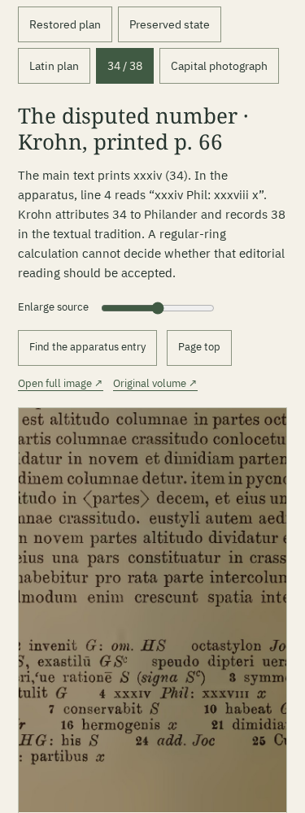

# The row that is not there: a sixth Gonia room

Reviewed 2026-10-23. Source and build are complete locally. This work did not
push a source branch, create a release or publish a Pages deployment. The new
room is intentionally described as a checkout addition in the README.

## What the learner can do

- Omit an inner colonnade while keeping the outer columns and enclosure fixed.
  Change the clear shaft gap and compare two narrow lanes with the joined
  passage in a separately measured plan strip.
- Trace either perimeter, assigning corners once. The outer ring has 42 distinct
  positions; the regular inner ring has 34. The model's total changes from 76
  present ring columns to 42, rather than silently shrinking the temple.
- Read five Latin excerpts with six selectable grammar notes and Greek
  architectural headwords tied to parts. Independent source selection survives
  sharing and browser history.
- Inspect complete scans of the Latin plan prescription and the XXXIV / XXXVIII
  apparatus. A control enlarges and centres the relevant passage.
- Compare the 1904 excavation publication's preserved-state plan with its proposed
  restoration, and inspect its actual photograph of an Ionic capital.
- Save all 76 potential column positions as CSV, or a portable illustrated HTML
  reading with both arrangements, readings, vocabulary, fonts, licenses and all
  five complete source images. The app also retains the complete six-room
  edition for offline use.

The [model and source decisions](colonnade-model.md) explain the chosen equal
grid, face measurements and historical limits. The numerical model does not
settle whether 34 or 38 is the appropriate textual reading. It does not assert
that a completed double colonnade was physically removed at Magnesia. It omits
porches, interior columns, bases, steps, roofs and structural or occupancy models.
The restored ancient building is explicitly distinguished from this experiment.

## Reviewed output





The desktop keeps the plan beside controls and vocabulary. Phones use the same
physical geometry with the long axis upright, and put arrangement controls before
the plan. The measured detail also becomes upright. No clipped partial plan is
presented as the complete default view. Horizontal scrolling remains available
for deliberate enlargement and for the count table.



The screenshots were opened and inspected. Labels, source credits, selected
states and both disputed numerals are readable. A table overflow, missing
keyboard focus on its scroll region, mismatched button names, and an initially
clipped phone plan were corrected during review.

[Actual saved reading](../examples/colonnade-reading.html) ·
[Eleven-page PDF](../examples/colonnade-reading.pdf) ·
[Actual coordinate CSV](../examples/colonnade.csv).
The PDF was printed from the offline HTML in Chromium. Its restored-plan and
capital pages were rasterized and inspected with their full source borders,
captions and library credits. This is a browser print, not an independently
typeset or tagged scholarly edition.

## Reproduction and evidence

At source commit `a8c9094`, a separate local clone received a fresh dependency
installation. Its complete build matched the working checkout byte for byte.
The build receipt records the exact edition and service-worker hash. Subsequent
changes in this review commit concern documentation and retained artifacts,
which do not enter the application edition hash.

The clean checks passed on Node 26.7.0 and the documented minimum major version,
Node 24.21.0. Their complete production files were identical.

```sh
npm ci
npm run check
npm run verify:colonnade
npm run test:colonnade -- /tmp/gonia-colonnade-review
python3 scripts/colonnade-source-review.py --online
```

`npm run check` completed lint, strict typechecking, 23 unit checks and the
production build. The [independent rational checker](colonnade-review/geometry.json)
enumerated all fourteen arrangement/gap combinations and checked 1,064 physical
positions plus shaft-to-wall distances. It imports no application mathematics.
Existing corner, spacing, entasis, fluting and segment oracles also passed.

The [browser receipt](colonnade-review/browser.json) records Chromium
153.0.8010.12 and Firefox 155.0 at 1440 and 375 pixels. Each journey checked all
fourteen rendered arrangements, equal drawing scales, fixed coordinates under
omission, actual dashed/present circles, keyboard controls, corner counting,
word-panel history, source zoom/pan, CSV contents and actual downloaded HTML.
All five embedded JPEGs matched the source bytes. The saved file opened with
the network disabled, with both plans, all images and embedded fonts available.
No script was required. The browser accessibility scans reported no violations
in those reviewed states; this is not a universal accessibility certification.

The saved HTML's embedded CSV link was also clicked offline in both browsers.
Its actual downloaded bytes matched the separately retained coordinate CSV:
[embedded download receipt](colonnade-review/embedded-csv.json).

The same four journeys disabled the serving origin, reloaded the app, changed
arrangement, decoded another source image, exported another complete reading
and followed navigation through the spacing room. They recorded no script
errors, external requests or page-width overflow. A substituted HTTP-200 source
response prevented export; removing the substitution allowed retry to succeed.

[Development-mode review](colonnade-review/development.json) separately exercised
the local `npm run dev` workflow and portable export in both browsers and sizes.
[Navigation review](colonnade-review/navigation.json) records twenty keyboard
journeys from all five earlier rooms into the new one, plus actual keyboard
panning of the phone's count table.

The [upgrade receipt](colonnade-review/upgrade.json) uses a separate clean build
of the previous five-room source at `2b6a869`. In Chromium and Firefox it held
back one new scan, then separately substituted a different scan with HTTP 200.
Neither incomplete edition displaced the previous offline workshop or produced
a falsely verified reading. After releasing/replacing the response, the complete
new edition installed and all six entry pages worked with the origin disabled.
Its reproduction command is:

```sh
node scripts/colonnade-upgrade.mjs path/to/previous-dist /tmp/gonia-colonnade-upgrade.json
```

[Source review](colonnade-review/sources.json) reproduced both Latin JPEGs from
the identified complete 1912 PDF and compared all three current Heidelberg image
responses with the bundled bytes. The library manifest's attribution and Public
Domain Mark were checked. The [identity registry](colonnade-source-identities.json)
records endpoints, hashes and page mappings. Source images were read visually;
an OCR result was not used to decide the disputed numeral.

[Build receipt](colonnade-review/build.json) ·
[Download identities](colonnade-review/artifacts.json) ·
[Design decisions](colonnade-design.md).

## Run and publication handoff

Inside the checkout, run `npm ci` then `npm run dev`. Open
`http://127.0.0.1:4328/gonia/colonnade.html`. The production command is
`npm run build`; the complete static output is `dist/`, base `/gonia/`.
Build and browser evidence do not establish a hosted deployment. No catalogue
entry was changed to advertise a public URL which this session did not deploy.

Suggested repository description:
“Measured ancient architecture: change temple plans, read Greek and Latin, and
inspect the printed evidence.”

Suggested topics: `ancient-greek`, `architecture`, `vitruvius`, `geometry`,
`education`, `latin`.
