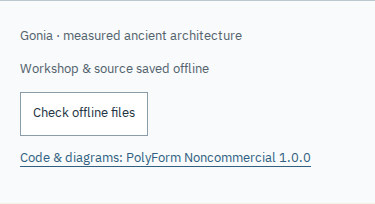

# The hoist after an independent audit

The original [loss workshop review](hoist-loss-review.md) verified the numerical
model, ordinary downloads and successful offline reloads. This follow-up tests
failure and recovery in the current checkout. It keeps the physical model,
source evidence, saved studies, browser behavior and publication separate.

## Try the actual work

Open the hoist and choose **Try three wheels at 90%** in **The same rope.
Unequal pulls.** Follow the three unequal supporting tensions and the total
work split. The [exact model](hoist-loss-model.md) is unchanged: the source
supplies the route, and the selected tension transfer is a modern raising
assumption. The fixed-tie stationary wheel has an explicitly chosen zero
resisting torque. This is neither a measured ancient efficiency nor equipment
selection advice.

Save an illustrated reading, change the live percentage, and open the file.
The reading retains its starting selection. It now contains the full project
license as well as both original font notices. JSON, SVG metadata and CSV
name the code/diagram license; the importer still accepts earlier version-two
records without that notice, and version-one records as ideal wheels.

If the connection stops while a source is being checked, choose **Cancel
saving**. Keyboard focus returns to the save action; the current trial stays.
An unattended stalled body reports a recoverable error after twenty seconds
without a chunk. Initial response headers have a separate sixty-second window
so requests queued behind other transfers are not mistaken for stalled bodies.
A source that keeps arriving can take much longer. A failed or cancelled group
aborts its outstanding reads and is not retained as a successful asset memo.

The footer's **Check offline files** verifies the actual saved bytes. A missing
or substituted file withdraws the ready claim in the other controlled rooms,
too. **Repair offline files** restores the complete edition without replacing
the experiment. First-install failures offer **Retry offline download**,
including a failed registration and a later failed installation. Retrying after
a first failure must re-register: the old registration object can have no
newest worker for `update()` to revive.

A saved page stays usable during a server error, a successful maintenance body,
and a stalled navigation. The worker verifies a network page against its own
edition and falls back to the verified saved page after a two-second window.
This prevents an old controller from combining a new entry document with old
resources. A genuinely different installed edition offers a reload rather
than claiming that the currently open reader is saved.

## Reproduced defects

The [before receipt](hoist-audit/before.json) was captured from `6b97277` in real
Chromium and Firefox, using the built files from that checkout.

| Failure                                                  | Observed before                                                  | Repair                                                                                 |
| -------------------------------------------------------- | ---------------------------------------------------------------- | -------------------------------------------------------------------------------------- |
| Substitute p.233 with another valid JPEG in CacheStorage | Inspection returned `complete: true`; footer still claimed saved | Inspect size and SHA-256 for every canonical file; verify every served cached response |
| Return HTTP 503 for a saved page                         | Maintenance body replaced the workshop                           | Reject unsuccessful responses; use the saved verified document                         |
| Return HTTP 200 with maintenance HTML                    | Maintenance body replaced the workshop                           | Check document identity rather than status alone                                       |
| Stall an illustrated source body                         | Save stayed disabled; no cancel action                           | Cancel, progress reporting, body inactivity expiry and clean retry                     |

These are actual learner failures. They were not inferred from passing unit
checks or a previously written progress report. Source substitution was already
rejected by the original illustrated export; the false claim was in the offline
inventory and cached delivery.

The expanded review also caught a native lifecycle interruption during a long
cold installation. The first implementation of the audit repair still waited
for one worker to survive the whole transfer. Under a shared 128,000-byte/second
payload budget, the first worker became redundant after 300 seconds. Its page
then retained a dead registration and never reached ready, even after the
server finished sending. The revised page re-registers after a failed attempt
only when the count of verified saved files has increased. Cached files are
checked again and reused. A persistent failure cannot trigger endless retries
without additional verified-file progress. The progress marker is not evidence
of readiness; the entire canonical inventory must pass before activation and
before the page claims it is saved.

The recorded native transition is consistent with Chromium's
[default five-minute request timeout](https://chromium.googlesource.com/chromium/src/+/28daf2b80ad72dd4686a318f37a4c832fd37a268/content/browser/service_worker/service_worker_version.cc).
It is an observed boundary for the tested Chromium, not a universal browser
lifetime guarantee. The implementation does not try to keep a worker alive
indefinitely. It preserves verified progress and recovers from interruption.

## Transfer and scheduling

The worker uses two background network reads; the study uses two foreground
source reads. Large background files start early, leaving smaller reads near
the native lifetime boundary. This limits the bytes lost if a native install
attempt is interrupted and leaves room for fonts and the current source study
under ordinary per-origin connection limits. Inventory hashing uses a separate
four-reader limit. There is no total active-transfer deadline.

The [earlier resumable run](hoist-audit/cold-four-requests.json), source `22f3475`,
used four background reads in pathname order. Its actual study completed in
68.530 seconds and the complete edition in 500.331 seconds. The lifecycle
receipt records worker 1 becoming redundant after 300.003 seconds of installation
and worker 2 activating. It sent 63,318,209 payload bytes, including requests
repeated after interruption. This was a single controlled run, not a general
network-speed benchmark. The payload budget covered every response on the
local origin, rather than assigning a separate budget to each file.

The [two-request, large-files-first run](hoist-audit/cold-two-requests.json)
completed its study in 58.763 seconds and the edition in 492.100 seconds, with
62,128,097 payload bytes sent. Relative to that earlier single run, the study
arrived 9.767 seconds sooner and 1,190,112 fewer payload bytes were sent. The
full-edition difference was only 8.231 seconds. These measurements support the
foreground scheduling choice; they are not a statistical performance claim.
Both runs retain the native interruption and successful recovery.

## Verification and reproduction

The browser audit operates corrupt/deleted caches, two open rooms, first
registration and first-install retries, refused network connections, actual
file downloads, stopped source bodies, substituted JPEGs and active source
bodies lasting longer than the inactivity window. The upgrade audit starts
from the earlier built edition, holds or substitutes a new source, keeps the
old edition usable offline, then recovers and checks the old tab's readiness
withdrawal. The room audit operates a substantive control and the offline check
in all fifteen rooms at desktop and phone widths in both engines.

```sh
npm ci
npm run check
npm run verify:hoist-loss
npm run test:hoist-loss -- /tmp/gonia-hoist-loss
node --import tsx scripts/hoist-loss-cases.ts | python3 scripts/hoist-loss-oracle.py /tmp/gonia-hoist-loss
npm run test:offline-audit -- dist /tmp/gonia-offline-audit
npm run test:offline-rooms -- dist /tmp/gonia-offline-rooms
npm run test:offline-upgrade-audit -- /path/to/earlier/dist dist /tmp/gonia-upgrade
npm run test:cold-source -- dist /tmp/gonia-cold-source
```

Browser commands read a fixed build: do not rebuild their directory while they
run. The cold command intentionally takes several minutes. It uses an actual
shared payload scheduler and the browser's native lifecycle, not an accelerated
clock or a fabricated termination. The other browser audits use the installed
Chromium and Firefox. No browser installation or runtime dependency was added.

The retained evidence is split by purpose:

| Record                                                             | What it checks                                                                                                                                       |
| ------------------------------------------------------------------ | ---------------------------------------------------------------------------------------------------------------------------------------------------- |
| [Fault and recovery](hoist-audit/offline.json)                     | Actual damaged/missing cache bytes, first-install retries, cross-tab withdrawal, navigation fallback, cancellation, idle expiry and slow active body |
| [All fifteen rooms](hoist-audit/rooms.json)                        | Sixty browser/viewport/room combinations with operated controls and offline checks                                                                   |
| [Existing installation upgrade](hoist-audit/upgrade.json)          | Held/substituted source, prior offline edition, recovery and an old open tab                                                                         |
| [Hoist browser workflow](hoist-audit/browser.json)                 | Controls, native files, snapshots, source hashes and origin-disabled use                                                                             |
| [Independent force/work oracle](hoist-audit/oracle.json)           | 1,530 exact-rational cases, 104 DOM states and 844 native CSV rows; 64,388 comparisons                                                               |
| [Clean build](hoist-audit/build.json)                              | Fresh Node 24 install, 72 passing unit checks and 142 reviewed output files                                                                          |
| [Worker algorithm comparison](hoist-audit/worker-equivalence.json) | Final compiled worker algorithm equals the sustained-transfer implementation; final manifest/UI identities are separate                              |

The two sustained-transfer recordings correspond to their stated source stages.
Later changes adjust phone footer layout, wheel-label placement and command
metadata. Their final manifest is separately rebuilt and checked; the compiled
worker algorithm is byte-identical to the recorded two-request version.

[Actual final illustrated reading](../examples/hoist-audit/reading.html.gz) ·
[Browser-printed A4 study](../examples/hoist-audit/reading.pdf) ·
[CSV](../examples/hoist-audit/measurements.csv) ·
[Editable JSON](../examples/hoist-audit/experiment.json) ·
[SVG](../examples/hoist-audit/diagram.svg).
Extract the gzip-compressed HTML before opening it. No generated study is
presented as an ancient artifact or measured reconstruction.



## Boundaries

The main equations and historical excerpts are unchanged. The original Greek
and Latin are not newly authenticated manuscripts; normalized excerpts and
new English retain their earlier scholarly limits. The primary print, fonts
and notices remain individually identifiable in the illustrated file.

Readiness can change after eviction, user deletion or damage. Visible pages
recheck on focus, restoration, worker changes, repair and a thirty-second
visible-page interval. Worker-detected damage invalidates controlled tabs;
this is not a claim that an out-of-band cache edit is observable instantly.
Repair requires the correct origin bytes to be reachable. A failed new edition
keeps the prior cache until the complete replacement activates. Interrupted
transfers can consume extra bytes; this is not a resumable HTTP Range protocol.
No physical lifting, sound perception, printer or universal accessibility
conformance is claimed.
