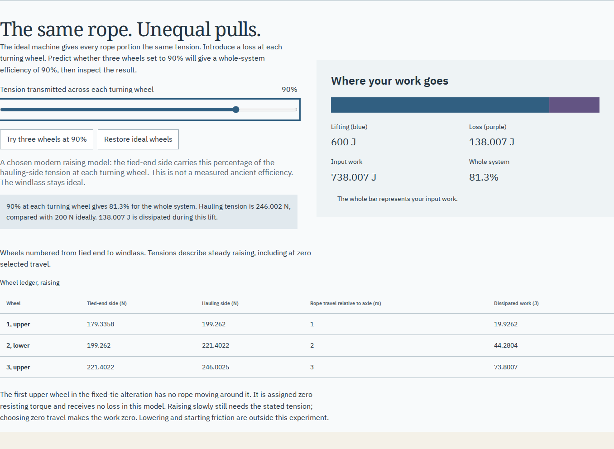
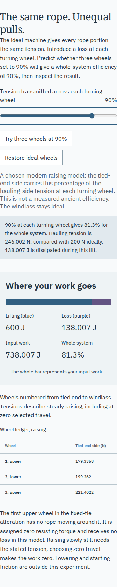

# Same rope, unequal pulls

This is a local extension of the existing hoist room, reviewed on 2026-11-01
(Pacific time). No new repository or room was added. The public demo, remote
source, local checkout and CI are separate verification boundaries; nothing
was pushed or deployed in this work.

## Try the experiment

Run the README quickstart with Node 24 or newer. Open
`http://127.0.0.1:4328/gonia/hoist.html#hw-losses`.
1. Choose **Try three wheels at 90%**. Before reading the result, predict whether
   ninety percent at each turning wheel gives ninety percent for the whole hoist.
2. Read the 81.3% result. Follow T1, T2 and T3 on the main drawing: their unequal
   values add to 600 N. The hauling end carries about 246.002 N, not the ideal 200 N.
3. Follow the wheel ledger from the tied end. Relative rope travel is 1, 2 and
   3 m at the three axles; the dissipated work is not identical at every wheel.
4. Change the tie to **Fixed support**. The first upper wheel now does not turn.
   Its selected resisting torque and modeled loss are zero. Two unequal pulls
   carry the same weight. Return to the source tie and select five wheels:
   hand force falls, while total input work rises for this same task.
5. Hold rope take-up instead of load rise. This changes the attained height;
   compare the actual smaller task rather than treating less work as a free gain.
6. Use arrow keys on the loss slider, restore ideal wheels, and save the
   experiment. Reopen older records, or keep the source-backed illustrated study
   with its wheel ledger, work division, JSON and CSV. A changed setting during
   saving does not change the file's captured starting selection.

The [model](hoist-loss-model.md) gives the exact equations, fixed-tie convention,
source boundary and full data-format behavior.

## What changed and why

The previous room at `18e5788` only modeled frictionless wheels. Its default
three supports each carried 200 N; load, rope and hand work were all 600 J.
The extension keeps that default and makes an additional assumption operable.
It calculates each supporting tension, each wheel's relative rope travel and
each local loss. Summed local loss independently accounts for extra input work.
The source text still supplies a rope route rather than a measured efficiency.

A direct file experiment also reproduced a real loss of current work: hold
`File.text()` pending, set the visible percentage to 80, then release an older
90% import. The earlier handler restored 90 and erased the newer setting.
The repaired handler checks both a state revision and an import request identity
before replacing anything; browser review verifies that the 80% trial survives.
Reading an ancient passage does not count as an experiment change.

## Design and review

The existing cool drawing-board palette stays: paper `#f8fafb`, board `#eef3f5`,
ink `#233341`, rope `#315f81`, load/loss `#635483`, rule `#bac7ce`. Noto Serif
carries the architectural headings and source language; IBM Plex Sans carries
controls and measurements. The retained frontend-design guidance was applied
to this existing room. No new decorative chrome, remote imagery or runtime
service was added. The distinctive object remains the reeved rope itself.

```
Supporting rope portions        Raise / wind / change tie
  T1     T2     T3                common experiment state
   |      |      |                         |
   +------+------+
          600 N                            v
                                 selected wheel transfer
                                          |
                                          v
                           lifting work + wheel losses
                           per-wheel tension / travel table
```

The first screenshot review exposed unreadable SVG text on the phone. The
final work bar has normal HTML values that stay readable at 375 px. The wide
wheel ledger scrolls within its keyboard-focusable region; it does not widen
the page. The main rope drawing keeps its existing enlargement and keyboard
panning. Numbered wheels connect the diagram with ledger order. The standalone
study gives the loss section and complete comparison their own print pages.




## Evidence

[Browser receipt](hoist-loss-browser.json) and
[exact-rational receipt](hoist-loss-oracle.json) retain observed results.
The [fresh Node 24 build inventory](hoist-loss-build.json) records 142 output
files byte-identical to the reviewed Node 26 build. The
[quickstart receipt](hoist-loss-quickstart.json) checks the real Node 24 dev
server in both engines and sizes, including illustrated downloads and the
absence of a development service worker.

| Check                                               | Observed result                                                                                                                           |
| --------------------------------------------------- | ----------------------------------------------------------------------------------------------------------------------------------------- |
| Full lint, strict TypeScript, unit checks and build | 71 tests passed; production output `dist/`                                                                                                |
| Independent exact force balance                     | 1,530 cases across all 51 selectable percentages, five routes, two controlled-distance choices and three scale/arm/travel cases           |
| Independent rendered and downloaded checks          | 104 actual DOM states, 844 native CSV rows and four saved SVGs; 64,388 comparisons in total                                               |
| Numerical disagreement                              | Maximum relative error below 5.72e-14; tolerance 2e-11                                                                                    |
| Engines and sizes                                   | Chromium 153.0.8010.12 and Firefox 155.0; 1440 and 375 px                                                                                 |
| Operated behaviors                                  | Native/keyboard controls, preset, ideal reset, fixed-tie stationary wheel, zero travel, share link, strict imports and legacy restoration |
| File snapshot and race                              | Click-time 90% reading retained while live state changed to 50%; delayed import preserved newer 80% trial                                 |
| Saved study                                         | Five source images decoded and SHA-256 checked; fonts and diagrams loaded from disk; no HTTP requests or scripts                          |
| Offline                                             | Origin connections refused and browser offline; reload retained the loss state, controls worked, complete study downloaded                |
| Accessibility                                       | No axe violations in the exercised states; no page errors or CSP refusal messages                                                         |
| Earlier ideal workflows                             | Original four browser configurations and native-artifact oracle passed with 844 CSV rows and literal SVG-route checks                     |

The independent Python oracle imports no application modules. It solves a linear
system for all rope tensions using exact rational Gaussian elimination, then
uses a literal per-route support/relative-travel fixture to calculate work. This
is independent of the implementation's geometric sum and route walker. The
same oracle checks actual DOM data attributes, the drawn useful-work width and
the complete native CSV fields. These are numerical/model checks, not formal
verification or physical measurements.

The original PDF was fetched again and its page regenerated; the [model](hoist-loss-model.md#source-boundary-and-modern-background)
records the source identities and the limits of the modern manufacturer background.
No ancient efficiency or equipment test was inferred from that material.

## Retained downloads and reproduction

The actual Chromium desktop downloads are in [examples/hoist-loss](../examples/hoist-loss/):
editable JSON, measured SVG, complete 211-row CSV, gzip-compressed standalone
HTML and its 15-page browser-printed A4 PDF. The new work explanation and
wheel ledger fit together on page 3; the complete five-route comparison is on
page 5. Both were checked as rendered pages and as extracted text. Extract the HTML before opening it.
The source pages, notices and fonts keep their own licenses; new code and
teaching material retain this repository's PolyForm Noncommercial terms.

```sh
npm ci
npm run check
npm run verify:hoist-loss
npm run test:hoist-loss -- /tmp/gonia-hoist-loss
node --import tsx scripts/hoist-loss-cases.ts | python3 scripts/hoist-loss-oracle.py /tmp/gonia-hoist-loss
npm run verify:hoist
npm run test:hoist -- /tmp/gonia-hoist-ideal
npm run verify:hoist-files -- /tmp/gonia-hoist-ideal
```

Browser commands serve the existing `dist/` on isolated local origins. Do not
rebuild it while a browser review runs. The source oracle uses only Python's
standard library; there is no new runtime dependency. Existing Playwright
Chromium and Firefox installations are required. The CI workflow includes the
new checks, but no remote CI execution or success is asserted.

## Limits and handoff

The common per-wheel transfer is a deliberately simple raising model. It omits
material-specific bearing/rope behavior, acceleration, starting and static
friction, lowering, slipping, strength, frame loads, variable drum layers and
operator capacity. Choosing 50% does not identify a particular ancient device.
The stationary-wheel equality is an assumption; rest alone does not establish
its real static tension relation. Neither speakers, physical printers nor
lifting equipment were tested. The exported PDF is not a claim of accessible
PDF conformance. Offline operation was checked for the current installed edition;
this report does not claim a new general service-worker recovery audit.

The loss extension is local and committed for review. It is not added to the
public catalogue because its published lesson and immutable review are not yet
available. The existing source/model/translation limitations remain in force.

Suggested description: “Follow Vitruvius's rope route, compare unequal tensions, and see where a hoist's input work goes.”
Topics: `ancient-architecture`, `vitruvius`, `mechanics`, `education`, `latin`, `offline`, `typescript`.
