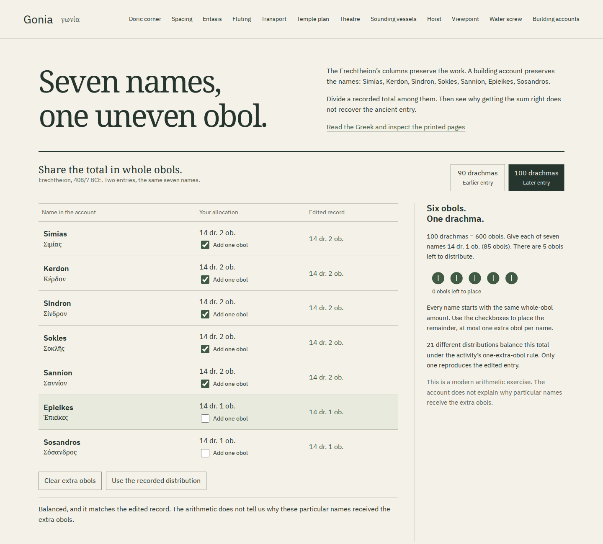
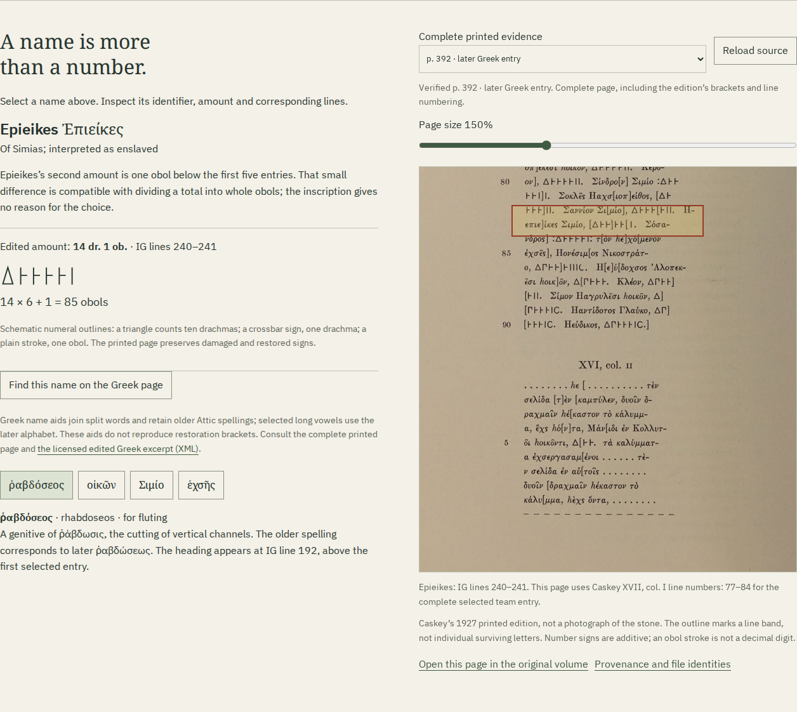

# Building accounts: local review

This room extends Gonia’s fluting geometry with an account of the people named
for the work. Its question is deliberately small: can you recover the seven
edited payments merely by balancing their sum?

The implementation, complete sources and files below are committed locally.
No push, public deployment or hosted-file identity is claimed for this room.
The existing public eleven-room edition and this twelve-room local build are
separate states. Officina’s public catalogue has not been changed to point
at an unavailable new route.

## Try the ledger

From the repository, with Node 24 or newer:

```sh
npm ci
npm run dev
```

Open `http://127.0.0.1:4328/gonia/ledger.html`. The documented production
command, `npm run build`, writes `dist/`; `npm run preview` serves it on the
same port after the development server is stopped.
1. Keep the 100-drachma entry. Every name starts with 14 drachmas and one
   obol. Place the five remaining obols beside the first five names.
2. Reveal the account. The edited amounts match your allocation.
3. Remove Simias’s extra obol and give it to Sosandros. The sum still balances,
   but the allocation differs from the edited entry. There are twenty-one
   balanced choices under this activity’s rule.
4. Select Sosandros and find his name on the Greek page. His first entry
   includes a possessive identifier; the second omits it. The lesson does
   not insert the missing words into the second entry.
5. Switch to the 90-drachma entry. One extra obol balances it. Compare
   the seven alternative choices with the actual edited entry.
6. Read **Σιμίο**. The Greek possessive form and the modern interpretation
   of an ownership relationship are explained separately. A payment entered
   beside a person’s name does not establish personal control of the money.



The phone view keeps the seven names, allocation controls and recorded amounts;
the source pane can enlarge and pan. [Complete 375-pixel view](assets/ledger-375.png).

## Read the evidence and keep a copy

[Open the actual saved HTML](../examples/ledger-reading.html),
[its fifteen-page A4 PDF](../examples/ledger-reading.pdf), or
[its exact comparison CSV](../examples/ledger-comparison.csv).
The retained example intentionally balances while differing from the record.
The HTML works as a local file without the site; its CSV and licensed Greek
XML excerpt can be downloaded from the document itself.



The source pane displays complete 1927 printed pages. They are not photographs
of the inscription. A highlight identifies a line band; it does not assert
that every highlighted letter or number sign survives. The [source note](ledger-model.md)
explains modern IG versus Caskey line numbering, the edited restorations,
ownership interpretation and the activity’s limits.

## Recorded verification

| Workflow                                            | Result and retained evidence                                                                                                                                                                                                                                                                                                                                  |
| --------------------------------------------------- | ------------------------------------------------------------------------------------------------------------------------------------------------------------------------------------------------------------------------------------------------------------------------------------------------------------------------------------------------------------- |
| Check the primary edited excerpt                    | All 24 retained line texts and inline markup match the downloaded IG XML. [Source receipt](ledger-review/source-receipt.json) records the original XML identity. All four complete scans were visually inspected.                                                                                                                                             |
| Independently read the number signs                 | Python reads additive Δ, drachma and obol signs directly from the retained Greek, including bracketed editorial supplies. It recovers 540 and 600 obols and checks all 256 activity masks, seven and twenty-one balanced choices. [Oracle receipt](ledger-review/oracle.json).                                                                                |
| Operate Chromium and Firefox at 1440 and 375 pixels | Keyboard allocation, reveal focus, both entries, all seven names and source bands, zoom, Greek notes, history, shared URL, native CSV/HTML downloads and source retry pass. No page errors or serious/critical axe violations. [Browser receipt](ledger-review/browser.json).                                                                                 |
| Remove the actual production origin                 | Both engines reload from the complete cache, switch entries, load the Greek source and save a new illustrated reading. The original server rejects connections as well as the context being offline.                                                                                                                                                          |
| Open the saved study as a local file offline        | Four source images decode; all three font files are embedded. No HTTP requests occur. CSV and XML downloaded from that file match their originals byte for byte. All four browsers’ native study downloads have the same SHA-256.                                                                                                                             |
| Inspect the real HTML and printed PDF               | The saved HTML contains four byte-identical JPEGs, all fonts and complete font notices. The 15-page PDF contains the seven names, all four Greek working words and licenses. All four original source JPEGs can be recovered byte for byte. [Artifact receipt](ledger-review/artifacts.json).                                                                 |
| Substitute another valid JPEG or font               | Both browsers withhold the unverified source/reading. No incomplete download occurs. Removing the substitution allows retry to save successfully. Four cases are in the browser receipt.                                                                                                                                                                      |
| Upgrade an existing eleven-room installation        | Hold a new scan, then separately substitute a different scan. Both browsers keep the old cache until recovery; the old room remains usable offline after a rejected update. Recovery gives one complete cache of 109 files, retires the old cache, and supports old and new rooms with the origin unavailable. [Upgrade receipt](ledger-review/upgrade.json). |
| Use the documented development server               | An isolated Node 24.21.0 checkout runs Vite without warnings. Both browsers at 375 pixels load the verified page, operate the keyboard allocation and restore the shared state after reload. [Development receipt](ledger-review/development.json).                                                                                                           |
| Install and build independently                     | `npm ci` and `npm run check` pass under Node 24.21.0: formatting, typecheck, 47 tests and production build. All 110 output files are byte-identical with the reviewed Node 26.7.0 workspace build. [Build identity](ledger-review/build-identity.json).                                                                                                       |

The source text, model, source build, native browser downloads and local offline
behavior are supported separately. These receipts establish no public deployment,
CI run, ancient rounding procedure, daily income or modern monetary value.

## Review commands

With the browser binaries installed and Poppler (`pdftotext`, `pdfimages`,
`pdfinfo`) available:

```sh
REVIEW_DIR=/tmp/gonia-ledger-review
npm run check
npm run verify:ledger
npm run test:ledger -- "$REVIEW_DIR"
node --import tsx scripts/ledger-cases.ts | python3 scripts/ledger-oracle.py "$REVIEW_DIR"
npm run verify:ledger-files -- "$REVIEW_DIR"
```

The browser harness serves the existing `dist/` itself. Do not rebuild it
while that harness is running. Python checks use its standard library and
Poppler; no scientific Python packages are needed. The previous upgrade input
was a clean Node 24 build of source `7fab064`, the eleven-room edition at
the start of this work.

For the upgrade review, set `PREVIOUS_DIST` to the directory of a previously
built edition and run `node scripts/ledger-upgrade.mjs "$PREVIOUS_DIST" upgrade.json`.

The Firefox review reproduced a real display failure: reusing a zoomed image
and awaiting `decode()` could reject a valid repeated blob. The viewer now loads
a fresh verified image before replacing the displayed one. “Find this name”
also centers the right-hand Greek column when enlargement hides the page margins.
The final four browser workflows exercise that sequence successfully.

Suggested repository description: “Explore ancient architecture through measured models, original texts and the people in a building account.”
Topics: `ancient-greek`, `architecture`, `epigraphy`, `geometry`, `education`,
`typescript`, `offline-first`.
