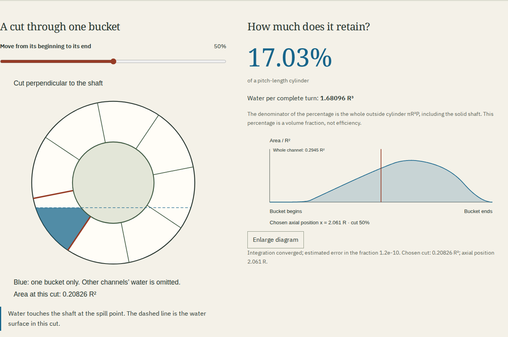
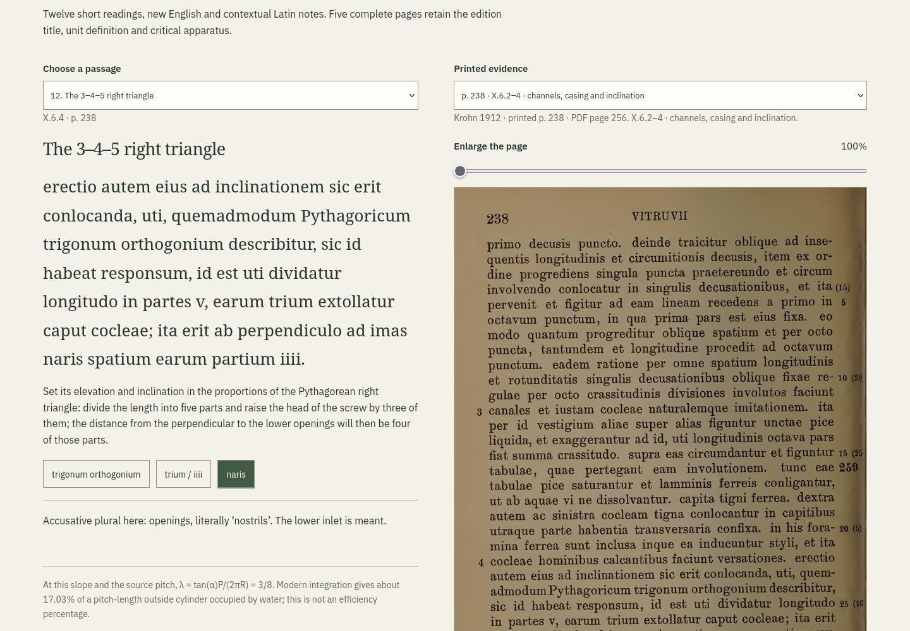
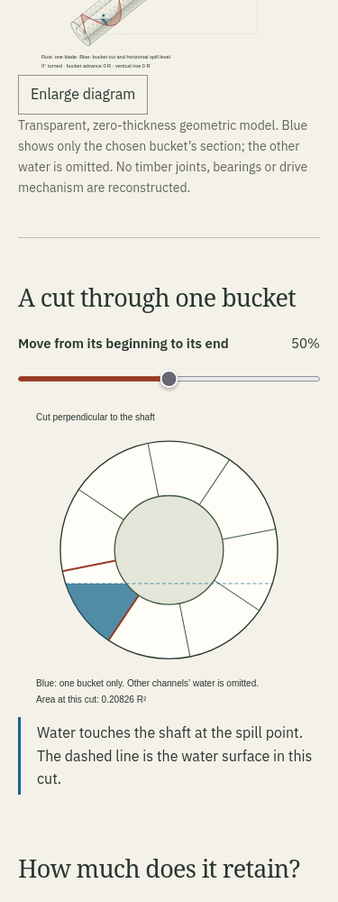

# Water screw: direct review

This record describes the reviewed local production build. Publication is a
separate claim: see the completed [public review](screw-publication.md).

The [clean Node 24 checkout](screw-clean.json) reproduced all 101 output files byte for byte.

The [mathematical model](screw-model.md) distinguishes edited source dimensions,
the conventional pitch interpretation, modern alterations and ideal water capacity.

## Try a retained bucket

Keep the source geometry and advance the construction from one strip to all
eight starts. One strip takes eight grid advances to return to its starting
circumferential line; its full pitch is eight times the spacing between starts.
Then compare the source, half-pitch and quarter-pitch rows. Quartering the pitch
raises water fraction from about 17.03% to 44.33%, while reducing ideal water per
turn from about 1.681 to 1.094 R^3. A fuller pitch-length cylinder can deliver
less water per revolution because the cylinder itself has become shorter.

Alter the angle to 50 degrees: only an outer pocket remains. At 65 degrees the
source-pitch model retains no bucket. Restore the source triangle, turn once,
and watch the selected bucket advance one pitch. Finally read passage 3 and open
printed p.62: the sixteen-digit foot comes from Vitruvius's own unit definition.

## Recorded workflows

| Actual workflow                                                        | Retained evidence                                                                                                                                                   |
| ---------------------------------------------------------------------- | ------------------------------------------------------------------------------------------------------------------------------------------------------------------- |
| Re-render the five complete source pages from the identified PDF       | [Source report](screw-sources.json); all JPEGs byte-identical with Poppler 24.02.0                                                                                  |
| Independently integrate 120 geometries and 2,040 sections              | [Radial oracle](screw-oracle.json); largest fraction difference about 1.47e-8                                                                                       |
| Operate production in Chromium and Firefox at 1440 and 375 pixels      | [Browser report](screw-browser.json); keyboard, history, six construction steps, regimes, full timed turn, twelve readings and five source pages                    |
| Inspect actual SVG coordinates and native files                        | [Artifact report](screw-artifacts.json); 68 snapshots, 2,412 CSV sections, four paper wraps and eight embedded readings                                             |
| Open the native saved HTML as a local file without networking          | No script, no external network requests, five decoded scans, both fonts; all 108 language fields and complete code/font notices retained                            |
| Print the actual saved HTML                                            | [24-page A4 PDF](../examples/screw-reading.pdf), 2,695 selectable words, all 108 language fields in page bounds, five extracted JPEGs byte-identical, no JavaScript |
| Hold a source response or substitute another valid JPEG during upgrade | [Upgrade report](screw-upgrade.json); old ten-room edition remains usable offline; viewer withholds the unverified page; no incomplete reading download             |
| Recover, then disable the local origin                                 | All eleven rooms work; all 100 worker-inventory files are cached; inspection does not recreate deleted caches                                                       |

The geometric oracle integrates radial strips with 96-point Gauss-Legendre
quadrature and independently sums along the shaft with SciPy. It does not import
application code or use the app's piecewise wet endpoint. The artifact review
also reconstructs the wet endpoint numerically and checks actual rendered areas,
pitch slopes, axial positions, horizontal spill lines and displayed volumes.
The largest SVG polygon-area difference in those snapshots is about 1.25e-5 R^2.

The model's five meaningful unit checks also constrain rounded published design
points, the shallow wet-tip regression, tiny pockets, source proportions,
water-height conservation, one-turn displacement and ambiguous shared links.
The full repository check passed 44 tests. Those checks support the observed
workflows; they do not establish real hydraulic performance or physical assembly.

## Review it yourself

Use Node 24 or newer and `npm ci`, then `npm run check`. The independent numerical
scripts require NumPy and SciPy (review used NumPy 2.5.4 and SciPy 1.18.1).
`uv venv` and `uv pip install numpy scipy` can supply an isolated environment.

```sh
npm run verify:screw
node scripts/screw-browser.mjs "$REVIEW_DIR"
node --import tsx --input-type=module -e 'import {screwPassages} from "./src/screw-content.ts"; console.log(JSON.stringify(screwPassages))' > readings.json
python3 scripts/screw-artifacts.py "$REVIEW_DIR/review.json" --readings readings.json
python3 scripts/screw-sources.py --pdf "$KROHN_PDF"
node scripts/screw-upgrade.mjs "$PREVIOUS_DIST" upgrade.json
```

The previous build used for upgrade was a clean build of source `2ccd4a2`,
the ten-room main branch at the start of this work. The browser script accepts
a public base URL as its third argument; that replay disables browser networking
after installation, whereas the local replay disables the actual test origin.

The [compressed native HTML](../examples/screw-reading.html.gz) expands to
3,343,708 bytes, SHA-256
`c41ab1d586029c71856e47ff8484dab09584ca8aab3557e0959a2c5d77e115b7`.
The PDF is SHA-256
`8cf0e34291c3440297b8bceb03ea6c6a3ced8bcea20889fa16c125d5c405902d`.
Other native downloads are the [machine SVG](../examples/screw-diagram.svg),
[paper wrap](../examples/screw-wrap.svg) and [measurements](../examples/screw-measurements.csv).






