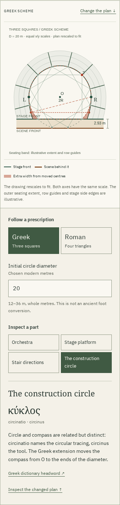

# Twelve points. Two theatres.

Reviewed 2026-10-23. The seventh Gonia room turns Vitruvius V.6–7 into a
measured construction: four triangles for the Roman plan, three squares for
the Greek, and a consequential move of the Greek compass to opposite ends
of the initial diameter. [Model and source decisions](theatre-model.md).

## What changed for the learner

Five stages connect the printed commands to the drawn lines. Trace one polygon,
inspect one of twelve vertices, switch plans, and compare their stage depths.
Move a cross-section to see how the two lower arcs differ from continuing one
circle. Source-foot platform heights remain distinct from the chosen metre
scale. The seating extent, row guides and stage side edges are illustrative.

Ten selected Latin passages have new English translations, grammar notes and
links into five complete printed pages. The reading identifies Krohn's printed
`sinistram` and the apparatus's `dextram`; it does not silently settle the
transmission. Leake's 1824 Greek diagram and the Roman plan in Morgan's 1914
translation are identified as later interpretations, not archaeological surveys.



The SVG plan has equal horizontal and vertical scales. On phones it uses an
upright layout with the same physical coordinates. Enlarged sources deliberately
pan inside their own labelled region; the page itself does not overflow.
The selected screenshots and rasterized PDF pages were visually inspected.
Compass labels were moved clear of the circular outline during that review.

## Downloadable work

[Actual HTML download](../examples/theatre-reading.html),
[17-page browser PDF](../examples/theatre-reading.pdf),
[SVG](../examples/theatre.svg) and [CSV](../examples/theatre.csv) are retained
with [hashes](theatre-review/artifacts.json). The HTML includes both completed
plans, the saved construction, all ten passages, vocabulary, all seven complete
source images, embedded fonts and redistribution notices. It opens from disk
without scripts or external requests. Its coordinate link is embedded.

The [print check](theatre-review/print.json) uses Poppler's layout-preserving
text extraction to find all 50 complete Latin, English, headword, gloss and
grammar fields. The Greek plan, a bilingual reading page and the full apparatus
page were rasterized and inspected. This is an untagged Chromium print, not a
separately typeset scholarly edition.

## Meaningful verification

```sh
npm ci
npm run check
npm run verify:theatre
npm run test:theatre -- /tmp/gonia-theatre-review
node --import tsx scripts/theatre-print.ts /tmp/gonia-theatre-review/theatre-reading.pdf
```

A fresh archive of runtime commit `c46adab` received a clean install on Node
24.21.0. Lint, strict typechecking, 30 tests and the production build passed.
All 63 production files matched the working build byte for byte:
[build inventory](theatre-review/build.json). The static output is `dist/`,
base `/gonia/`. Documentation and review artifacts do not enter its edition hash.

The [independent oracle](theatre-review/geometry.json) checks 75 configurations
and 7,575 cross-sections. It numerically integrates separately parameterized
widths and checks distances to the compass centres. Its largest absolute area
difference is approximately 1.14e-13 square metres, below the 1e-8 tolerance.

The [browser journeys](theatre-review/browser.json) use Chromium 153.0.8010.12
and Firefox 155.0 at 1440 and 375 pixels. Each checks 33 rendered configurations,
native controls, keyboard point/width changes, all readings, all source hashes,
share/reload, actual SVG/CSV/HTML downloads and the standalone reading. Browser
SVG path sampling approximates circular arcs internally: its area check allows
0.05%, independently of the much tighter mathematical oracle. Exact line and
cross-section coordinates are also checked; a successful metadata comparison
alone is not treated as a rendered-geometry check.

Each journey disconnects the serving origin and visits all seven rooms, decodes
a source and saves another complete reading. The reviewed states have no script
errors, external requests, page-width overflow or automated WCAG A/AA findings.
That scan is bounded evidence, not a universal accessibility certification.
Substituting a wrong source image with HTTP 200 prevents a verified download.

The [upgrade journeys](theatre-review/upgrade.json) start with the six-room
build at `1e1ba81`. In each browser, holding a new image or substituting a wrong
one preserves the old offline edition. Releasing the complete correct source
set allows all seven rooms to work with the origin disabled. Reproduce with:

```sh
node scripts/theatre-upgrade.mjs path/to/previous-dist /tmp/gonia-theatre-upgrade.json
```

## Publication

Source commit `204c607` and Pages commit `403d72a` were pushed on 2026-10-23.
The latter is a normal fast-forward publication retaining prior hashed assets.
GitHub reported the branch build complete. All 63 public files, totalling
20,556,065 bytes, matched the reviewed inventory by SHA-256.

The [direct HTTPS review](theatre-review/hosted.json) exercised the public
[theatre room](https://antonsoo.github.io/gonia/theatre.html) in both browsers
and both widths. It switched the plans, compared the alteration, used the
keyboard cross-section, decoded the apparatus scan, and downloaded the actual
HTML, SVG and CSV. The coordinate link inside the standalone HTML produced
identical CSV bytes. After disconnecting the context, every one of the seven
public entry pages and the selected source image remained available.

The colonnade room is included in the same published edition. Its original
review below predates this publication. No package-registry release or tag is
claimed.
