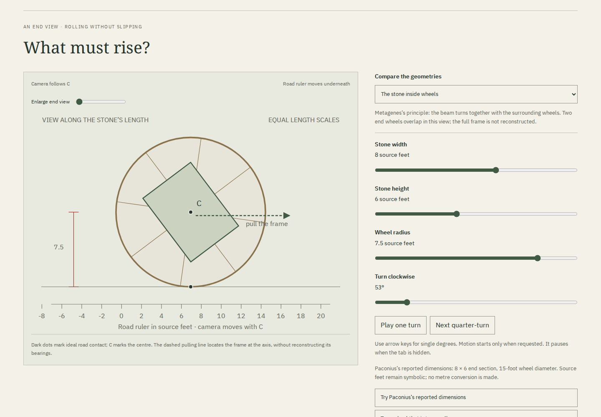

# Before the column stood: review

[The transport room](https://antonsoo.github.io/gonia/transport.html) adds a
different architectural problem: the stone's journey before it becomes a
standing member. A bare rectangle must rise and fall. Wheels keep its centre
at one height, provided the corners clear the road throughout the turn.
The [source-length interpretations and derivation](transport-model.md) remain
separate from the report that Paconius's machine veered.

## What the learner can do

Compare three kinds of motion, inspect the whole revolution and test a wheel
that clears at 0° and 90° but fails between them. The end view keeps equal
length scales; a separate height graph labels its different degree/length axes.
The largest permitted sections remain inside the drawing, including their
attempted ground penetration. A separate ruler band keeps numbers out of the
obstructed body. The vertical frame contains the whole turn's envelope, so
playback does not resize it at every angle.

The source case takes an 8 × 6 end section and 15-foot wheel diameter under
the declared readings. Its 2.5 source feet of minimum clearance cannot explain
the reported veering. No steering, soil, rope-force or matched-mass estimate
is invented. The initial Metagenes section is a chosen illustration because
the passage supplies no beam cross-section.

Five Latin excerpts, nine grammar notes and three Greek headwords remain beside
the original evidence. Clicking a word places its explanation directly after
that sentence while preserving the word's viewport position. Saved readings
include all nine notes, both original JPEGs, both fonts and their full licenses.
The source pane can start at X.2.11, restore the page top, enlarge and pan the
full print. The gap in the frame description and the apparatus remain visible.

## Recorded checks

| Evidence                                                        | Result                                                                                                                                                                     |
| --------------------------------------------------------------- | -------------------------------------------------------------------------------------------------------------------------------------------------------------------------- |
| Anonymous public clone, Node 24.22.0, `npm ci`, `npm run check` | Pass; resulting 44-file build equals the reviewed and served build                                                                                                         |
| Independent geometric model                                     | 1,215 cases; successive rigid rotations about actual support vertices                                                                                                      |
| Actual public SVGs and native CSVs                              | 84 rendered poses, 7,240 CSV samples, circular radii, road rulers and height curves checked independently                                                                  |
| Maximum observed coordinate difference                          | Below 1.5e-14 source/chosen units in the recorded cases                                                                                                                    |
| Chromium and Firefox                                            | 1440 and 375 px; real controls, keyboard play/pause, history, source reading, malformed links and downloads                                                                |
| Small and large bounds                                          | Smallest plot ticks remain on the axis; largest clear and obstructed sections remain inside the SVG                                                                        |
| Native illustrated reading                                      | Two exact JPEGs, two exact fonts and nine grammar notes; no scripts or runtime HTTP requests                                                                               |
| Native print                                                    | Seven-page A4 PDF; opening diagram and both complete source pages visually inspected                                                                                       |
| Source reproduction                                             | Both JPEGs reproduced from the identified original and the bundled PDF; seven bundled asset identities verified                                                            |
| Automated accessibility                                         | Zero selected WCAG 2/2.1 A/AA findings in the exercised states; automatic readout announcements are off during playback and restored when paused                           |
| Offline use                                                     | Reload, select a source page, save another complete reading and navigate through all five rooms with local origin closed or external network offline                       |
| Prior-edition upgrade                                           | Four browser/scenario combinations: hold/substitute the new scan, preserve the old four-room cache, refuse an unverified reading, recover, then use all five rooms offline |
| Development quickstart                                          | Four fresh Node 24 journeys; real word feedback and downloads, zero service-worker registrations                                                                           |
| Earlier entasis reading                                         | All four hosted journeys pass; native bytes still equal the original retained packet after lossless gzip packaging                                                         |

The machine-readable receipts are in [transport-review/](transport-review/).
The previously hosted 38-file build was independently verified before it became
the upgrade starting point. The new worker's complete inventory has 43 files;
the 44th production file is the worker itself. A pending or invalid new scan
cannot earn readiness or an illustrated download. These counts describe the
known build inventory, not a claim that no older files remain on the host.

## A reproduced playback defect

Firefox supplied an initial animation-frame timestamp of 302.56 ms after a
click-time `performance.now()` sample of 308 ms; the callback itself ran at
312 ms. The first draft mixed those clocks and floored the negative interval
to -1°, causing the geometry boundary to reject it before another frame was
scheduled. [The actual witness](transport-review/clock-witness.json) is retained.

Playback now starts from the first actual frame timestamp, clamps elapsed
progress and keeps the pose monotonic. The exact negative-time boundary has
a regression, and real keyboard starts, pauses and endpoint controls pass in
both browsers. Mobile reviews also request reduced motion: nothing starts
automatically, and manual degree/quarter-turn controls remain available.

## Native artifacts and publication

Inspect the actual [illustrated HTML](../examples/transport-reading.html),
[seven-page PDF](../examples/transport-reading.pdf) and
[full-turn Paconius CSV](../examples/transport-paconius.csv), downloaded from
the canonical public application. The older entasis packet is now gzip packed
to keep its tracked artifact below 5 MB; decompression preserves its original
SHA-256 `d921fe00efe64d5b032b4b1306a2e569d1814d30838fca14729fb4fca62efa71`.
Its published history was retained.

The transport room was introduced in
[`35f8d1d`](https://github.com/antonsoo/gonia/commit/35f8d1d), with subsequent
reading/axis/accessibility corrections in the current application source
[`487c68a`](https://github.com/antonsoo/gonia/commit/487c68a).
All 44 canonical responses match that reviewed production build. Public byte
hashes, browser behavior, independent geometry and source reproduction are
separate receipts. Documentation-only commits do not alter this edition.

The evidence covers the recorded cases and browser paths. It does not establish
archaeological reconstruction, the account's historicity, physical pulling
effort, steering behavior or the performance of a particular assistive device.
